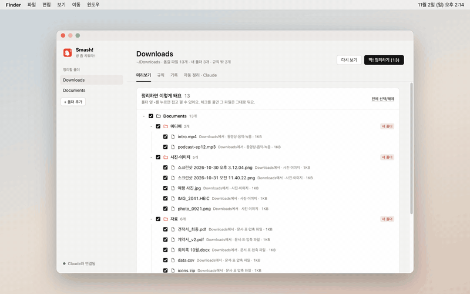
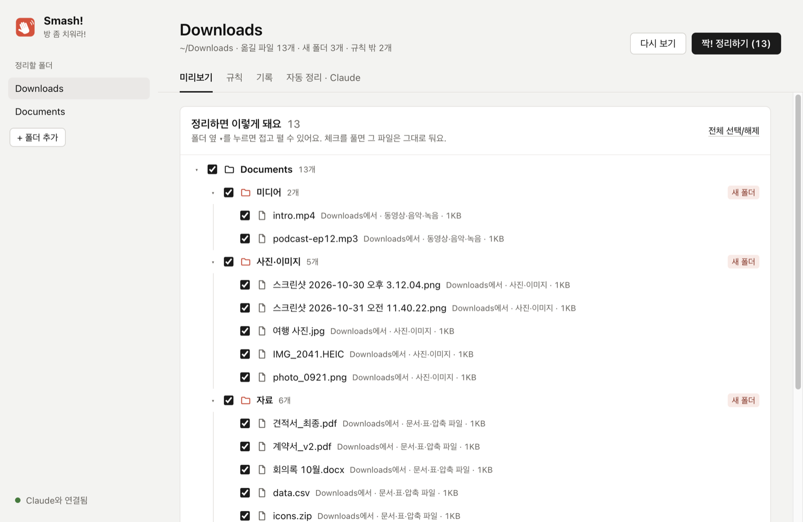
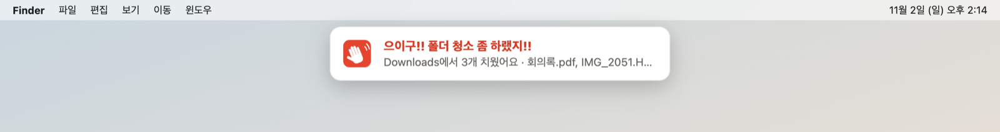

<p align="center"></p>

<h1 align="center">Smash! · 등짝 스매시</h1>

<p align="center">내가 정한 규칙대로 다운로드 폴더를 정리하는 Mac·Windows 앱.<br>
정리하기를 누르면 화면에 커다란 손바닥이 내려와 "찰싹!!" 하고, 파일은 제자리로 들어가 있다.</p>

<p align="center">
  <a href="https://github.com/ESeungJun/smash/releases/latest/download/Smash-macOS-arm64.dmg"><b>⬇ 맥 (애플 칩) 내려받기</b></a> ·
  <a href="https://github.com/ESeungJun/smash/releases/latest/download/Smash-macOS-x64.dmg"><b>⬇ 맥 (인텔) 내려받기</b></a><br>
  <a href="https://github.com/ESeungJun/smash/releases/latest/download/Smash-Windows-x64-Setup.exe"><b>⬇ 윈도우 (x64) 내려받기</b></a><br>
  <sub>macOS 12 이상 · Windows 10 이상 · 아직 코드 서명 전 · <a href="https://github.com/ESeungJun/smash/releases">모든 릴리스</a></sub>
</p>

<p align="center"><a href="README.md">English</a> · <b>한국어</b></p>

<p align="center"><a href="docs/video/smash.mp4"></a><br>
<sub>▶ <a href="docs/video/smash.mp4">고화질 영상 보기 (MP4, 4초)</a></sub></p>

---

"방 좀 치워라!" 엄마 손바닥이 등짝에 날아오기 직전에 듣던 말이다.
다운로드 폴더도 그 정도는 맞아야 할 것 같았다. 스크린샷, 설치 파일, PDF, 영상이 쌓여서 뭐 하나 찾기가 힘들었다.

Smash!는 한 번 정해 둔 규칙대로 파일을 내가 고른 폴더에 옮긴다.
옮기기 전에 무엇이 어디로 갈지 전부 보여 주고, 영구 삭제는 하지 않는다.
API 키 없이 내 컴퓨터에 로그인된 Claude와 같이 쓴다.

## 쓰는 법

1. 정리할 폴더를 고른다. 다운로드와 문서는 처음부터 들어 있다.
2. 미리보기를 본다. 정리한 뒤의 폴더 모양을 트리로 보여 주고, 새로 생길 폴더·중복·이름이 바뀌는 파일을 표시한다.
3. 그대로 둘 파일은 체크를 풀고 **짝! 정리하기**를 누른다.
4. 손바닥이 내리치는 순간 파일이 옮겨지고, 파일이 들어간 폴더가 열린다.

<p align="center"></p>

## 기능

- **읽히는 규칙**: 파일 종류(사진·동영상·문서·압축·설치 파일 등)를 고르거나 확장자를 넣고, 이름에 든 단어와 "N일 지난"을 더한다.
  할 일은 폴더로 옮기기 또는 휴지통으로 보내기. 만드는 동안 지금 폴더에서 맞는 파일 수를 바로 보여 준다.
- **말로 만들기**: "이름에 '계약서'가 들어간 PDF는 문서/계약서로 옮겨줘"라고 쓰면 Claude가 규칙을 채운다.
- **문서 폴더 기준 기본 규칙**: 다운로드 파일을 `문서/사진·이미지`, `미디어`, `자료`, `개발리소스`로 모은다. 7일 지난 설치 파일은 휴지통으로 보낸다.
- **자동 정리**: 켜 둔 폴더에 새 파일이 들어오면 다 받아질 때까지 기다렸다가(크기가 두 번 그대로인지 확인) 정리한다.
  창을 닫아도 메뉴 막대(윈도우는 알림 영역)에서 계속 지켜본다.
  끝나면 화면 위쪽에 "으이구!! 폴더 청소 좀 하랬지!!" 배너가 내려온다. 누르면 정리한 폴더가 열린다.

  
- **등짝 스매시**: 화면 전체를 덮는 투명 창에 손바닥이 나타나 힘을 모았다가 내리치고, 화면과 앱 창이 들썩인다.
  마우스는 그대로 통과한다. 효과와 폴더 열기는 설정에서 따로 끌 수 있다.
- **안전장치**
  - 영구 삭제 없이 시스템 휴지통으로만 보낸다.
  - 같은 이름이 있으면 덮어쓰지 않고 ` (2)`를 붙인다. 내용까지 같으면 중복으로 보고 휴지통으로 보낸다.
  - 숨김 파일, 다운로드 중인 파일, 폴더(git 저장소 포함)는 건드리지 않는다.
  - 설정한 폴더 밖으로는 옮기지 않는다.
  - macOS가 한글 파일 이름을 자모로 풀어 저장해도(NFD) 규칙 단어와 맞춰 비교한다. 그래서 "스크린샷" 규칙이 실제로 스크린샷을 잡는다.
- **기록·되돌리기**: 마지막 정리를 한 번에 되돌린다.

## Claude 연동 (API 키 없음)

- **이건 어디로 갈까?**: 규칙에 안 걸린 파일은 `claude -p`(도구 끔)에 물어본다. 이름·크기·날짜와 폴더 목록만 보내고 파일 내용은 보내지 않는다.
- **Claude Code·Claude Desktop용 MCP 서버**: "자동 정리 · Claude" 탭에서 등록한다.
  `CLAUDE_CONFIG_DIR`로 쓰는 다른 설정 위치까지 찾아 모두 등록하고, Claude Desktop 설정은 먼저 `.bak`으로 백업한다.
  그다음 Claude에게 "다운로드 폴더 정리해 줘"라고 하면 앱과 같은 규칙과 기록으로 정리한다.

서버 이름은 `smash`, 도구는 `list_targets`, `scan_folder`, `apply_plan`, `add_rule`, `undo_last`, `history` 6개다.
Claude 기능은 [Claude Code CLI](https://docs.claude.com/en/docs/claude-code)에 로그인되어 있어야 쓸 수 있고, 나머지는 없어도 된다.

## 설치

### 맥

| 맥 | 파일 |
|---|---|
| 애플 칩(M1 이후) | [`Smash-macOS-arm64.dmg`](https://github.com/ESeungJun/smash/releases/latest/download/Smash-macOS-arm64.dmg) |
| 인텔 칩 | [`Smash-macOS-x64.dmg`](https://github.com/ESeungJun/smash/releases/latest/download/Smash-macOS-x64.dmg) |

dmg를 열고 `Smash.app`을 응용 프로그램 폴더로 끌어 넣는다.
아직 Apple 공증 전이라 처음 열 때 막힌다.
**시스템 설정 → 개인정보 보호 및 보안**에서 Smash 옆의 **그래도 열기**를 누르거나, 터미널에서 아래를 실행한다.

```bash
xattr -dr com.apple.quarantine /Applications/Smash.app
```

### 윈도우

[`Smash-Windows-x64-Setup.exe`](https://github.com/ESeungJun/smash/releases/latest/download/Smash-Windows-x64-Setup.exe)를 실행한다.
코드 서명 전이라 SmartScreen 경고가 뜨면 **추가 정보 → 실행**을 누른다.
Windows 10 이상. 실제 윈도우 기기에서는 아직 테스트하지 않았다.

화면은 한국어와 영어를 지원한다. 처음에는 시스템 언어를 따르고, **자동 정리 · Claude → 언어 · Language**에서 바꿀 수 있다.

## 만든 재료

- **Electron**, 프레임워크 없는 순수 CommonJS. 스매시 효과와 배너는 포커스를 가져가지 않는 투명 `BrowserWindow`다.
- **Node 내장 테스트 러너**로 규칙 엔진, MCP 서버, 자동 정리 감시를 테스트한다.
- **stdio MCP**: 앱의 Electron 실행 파일을 `ELECTRON_RUN_AS_NODE=1`로 돌려서 Node를 따로 깔 필요가 없다.

Claude Code와 함께 만들었다.

## 개발

```bash
npm install
npm start          # 앱 실행
npm test           # 규칙 엔진·MCP·자동 정리 테스트
npm run icons      # assets/*.svg → build/icon.png, 트레이 아이콘
npm run dist:mac   # dist/Smash-macOS-*.dmg
npm run dist:win   # dist/Smash-Windows-x64-Setup.exe (macOS에서도 빌드됨)
```

- 설정: 맥 `~/Library/Application Support/Smash/config.json`, 윈도우 `%APPDATA%\Smash\config.json`. `SMASH_HOME`으로 위치를 바꿀 수 있다(테스트용).
- 빌드용 productName은 영문 `Smash`로 둔다. 실행 파일과 Helper 앱 이름이 이걸 따라가는데, 둘이 어긋나면 "Unable to find helper app"으로 앱이 바로 죽는다.
  화면 이름 "Smash!"는 `build/lproj`와 `app.setName`이 맡는다.

### 브랜치 (git flow)

- `main`: 릴리스된 코드만. 릴리스마다 `v1.0.0` 같은 태그를 단다.
- `develop`: 다음 릴리스를 모으는 곳. 기능은 `feature/이름`에서 만들어 `develop`에 합친다.
- 릴리스: `develop`에서 `release/x.y.z`를 따서 `package.json` 버전을 올리고, `main`에 합쳐 태그를 단 뒤 `develop`에도 다시 합친다.
- 급한 수정: `main`에서 `hotfix/x.y.z`를 따서 고치고 `main`·`develop` 둘 다에 합친다.
- 개발 중에는 버전을 올리지 않고 설치본만 바꾼다. 버전은 릴리스할 때만 올린다.
