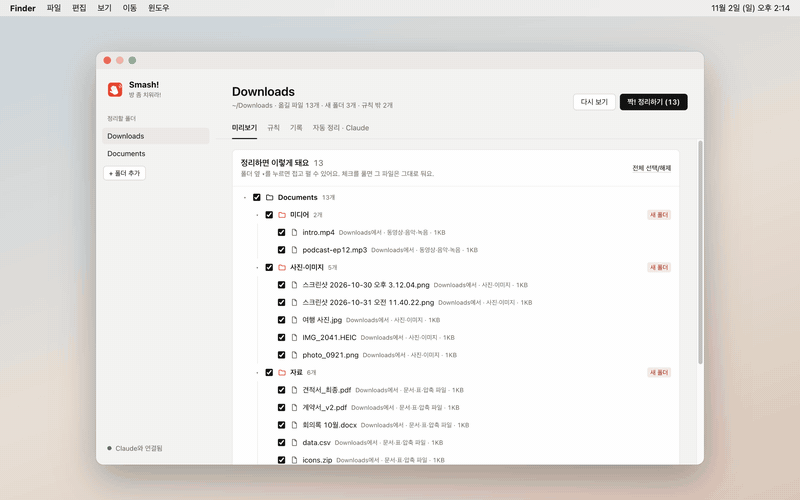
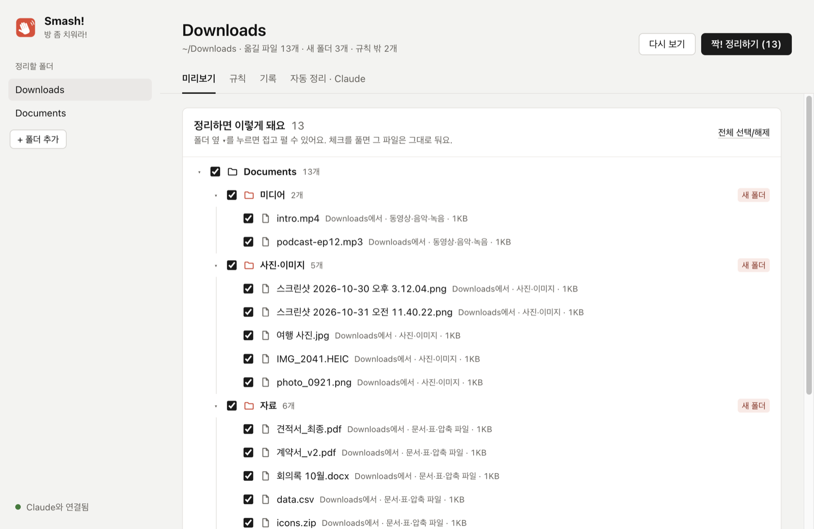
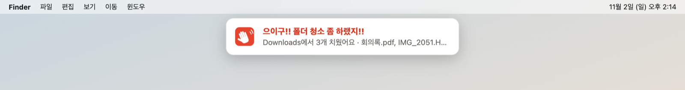

<p align="center"></p>

<h1 align="center">Smash! · 등짝 스매시</h1>

<p align="center">A folder-tidying app for Mac and Windows that sorts your Downloads by your own rules, with a slap.<br>
Press tidy and a giant palm comes down on your screen. "찰싹!!" Everything is in its folder.</p>

<p align="center">
  <a href="https://github.com/ESeungJun/smash/releases/latest/download/Smash-macOS.dmg"><b>⬇ Download for Mac</b></a> ·
  <a href="https://github.com/ESeungJun/smash/releases/latest/download/Smash-Windows-x64-Setup.exe"><b>⬇ Download for Windows (x64)</b></a><br>
  <sub>macOS 11+ (Apple silicon and Intel) · Windows 10+ · Mac app signed and notarized · <a href="https://github.com/ESeungJun/smash/releases">All releases</a></sub>
</p>

<p align="center"><b>English</b> · <a href="README.ko.md">한국어</a></p>

<p align="center"><a href="docs/video/smash.mp4"></a><br>
<sub>▶ <a href="docs/video/smash.mp4">Watch the full-quality video (MP4, 4s)</a></sub></p>

---

"방 좀 치워라!" (clean your room!) is what a Korean mom says right before her palm lands on your back.
My Downloads folder deserved the same treatment: screenshots, installers, PDFs and videos piling up until nothing could be found.

Smash! moves them into the folders you choose, by rules you set once.
It shows you exactly what will happen before anything moves, never deletes for good,
and works with the Claude you already have signed in on your computer, with no API key.

## How it works

1. Pick a folder to tidy. Downloads and Documents are set up for you.
2. Look at the preview. It shows your folders as a tree after tidying, with new folders, duplicates and renamed files marked.
3. Uncheck anything you want to leave alone and press **짝! 정리하기**.
4. The palm slaps, the files move, and the folder they went to opens.

<p align="center"></p>

## Features

- **Rules you can read** — pick file kinds (images, video, documents, archives, installers…) or type extensions,
  add words in the name and "older than N days", then choose: move to a folder or send to the Trash.
  While you build a rule it shows how many files in the folder match right now.
- **Say it instead** — write "move PDFs with '계약서' in the name to Documents/계약서" and Claude fills in the rule.
- **Documents-first defaults** — Downloads is sorted into `Documents/Images`, `Media`, `Files` and `Dev Resources` out of the box
  (`사진·이미지`, `미디어`, `자료` and `개발리소스` when the app runs in Korean). Installers older than 7 days go to the Trash.
- **Auto-tidy** — turn it on for a folder and new files are sorted once they finish downloading
  (the size has to stay the same twice). It keeps watching from the menu bar (notification area on Windows) after you close the window.
  When it's done, a banner drops in at the top of the screen: "으이구!! 폴더 청소 좀 하랬지!!" (roughly "Ugh!! Didn't I tell you to clean your folders!!"). Click it to open the folder.

  
- **The smash** — a transparent full-screen overlay: the palm appears, winds up and slaps, the screen shakes and the app window jolts.
  Mouse clicks pass through. Turn the effect or the folder opening off in settings.
- **Safe by design**
  - Nothing is deleted for good; it only goes to the system Trash.
  - Never overwrites: a file with the same name gets ` (2)`. Identical files are treated as duplicates and go to the Trash.
  - Hidden files, files still downloading and folders (git repositories included) are left alone.
  - Files never move outside the folders you've set up.
  - Korean names match whether macOS stores them composed or decomposed (NFC/NFD), so "스크린샷" rules actually catch screenshots.
- **History and undo** — undo the last run in one click.

## Claude, without an API key

- **Where should this go?** — for files no rule catches, Smash! asks `claude -p` (with tools disabled).
  Only names, sizes, dates and your folder list are sent, never file contents.
- **MCP server for Claude Code and Claude Desktop** — register it from the "자동 정리 · Claude" tab.
  It finds every Claude Code config, including ones under `CLAUDE_CONFIG_DIR`, and backs up Claude Desktop's config to `.bak` first.
  Then ask Claude to "tidy my Downloads" and it uses the same rules and history as the app.

The server is called `smash` and has six tools: `list_targets`, `scan_folder`, `apply_plan`, `add_rule`, `undo_last` and `history`.
Claude features need the [Claude Code CLI](https://docs.claude.com/en/docs/claude-code) signed in; everything else works without it.

## Install

### Mac

Download [`Smash-macOS.dmg`](https://github.com/ESeungJun/smash/releases/latest/download/Smash-macOS.dmg).
One file runs on both Apple silicon and Intel Macs.
Open it and drag `Smash.app` into Applications. The app is signed and notarized by Apple, so it opens without a warning.

Smash updates itself. When a new version is downloaded, the tray menu shows **Install vX.Y.Z and restart**.

If you used Smash 1.x and connected it to Claude, the first launch of 2.0 points that connection at the new app for you.

### Windows

Run [`Smash-Windows-x64-Setup.exe`](https://github.com/ESeungJun/smash/releases/latest/download/Smash-Windows-x64-Setup.exe).
It isn't code-signed yet, so if SmartScreen warns you, click **More info → Run anyway**.
Windows 10 or later. Not tested on a real Windows machine yet.

The app speaks English and Korean. It follows your system language; change it under **Auto-tidy · Claude → Language**.

## Built with

- **Tauri 2 + Rust** for the app, the rules engine and the folder watcher. The screens are plain HTML, CSS and JavaScript with no framework.
  The smash and the banner are transparent, non-focusable windows.
- **MCP over stdio**: Claude starts the app's own binary as `smash --mcp`, so nothing else needs to be installed.
- **cargo test** for the rules engine, MCP server and auto-tidy watcher.
- Moving from Electron (1.x) to Tauri (2.0) took the Mac download from about 120MB to a few MB.

Built together with Claude Code.

## Development

```bash
npm install
npm run dev        # run the app (needs Rust)
npm test           # cargo test (run with --test-threads=1, see below)
npm run build      # installer for this machine
npm run icons      # assets/*.svg → build/icon.png and tray icons
```

The rules engine lives in `src-tauri/src` (`organizer.rs`, `watcher.rs`, `claude.rs`, `mcp.rs`) and the screens in `src/renderer`.
`src/renderer/tauri-bridge.js` exposes the Rust commands to the screens as `window.tidy`.
Pushing a `feature/*` branch runs the tests and builds unsigned installers on GitHub Actions. Tags `vX.Y.Z` build the signed release.

- Settings live in `~/Library/Application Support/Smash/config.json` on Mac and `%APPDATA%\Smash\config.json` on Windows.
  Set `SMASH_HOME` to use another folder (handy for tests). Tests share that setting, so run them one at a time (`-- --test-threads=1`).
- `productName` stays plain ASCII `Smash`. The name "Smash!" shown in Finder and the menu bar comes from `build/lproj`.

Branches follow git flow: `main` holds releases (tagged `vX.Y.Z`), `develop` collects the next one,
and work happens on `feature/*`, `release/*` and `hotfix/*` branches.
