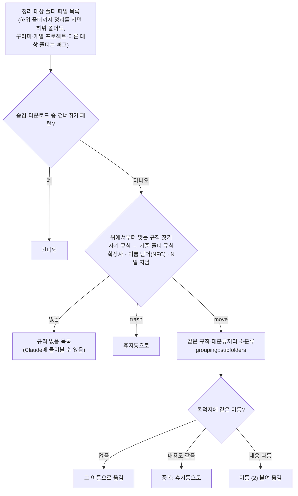
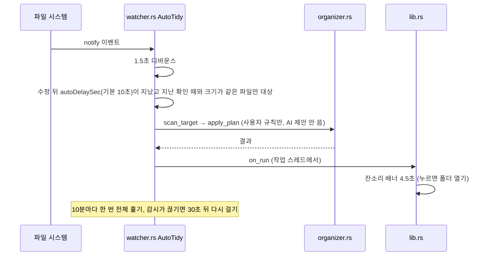
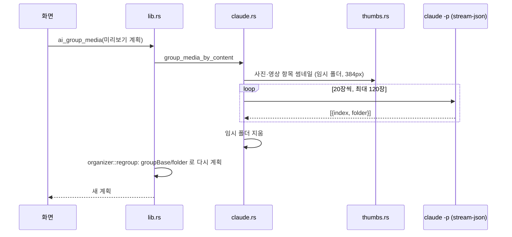
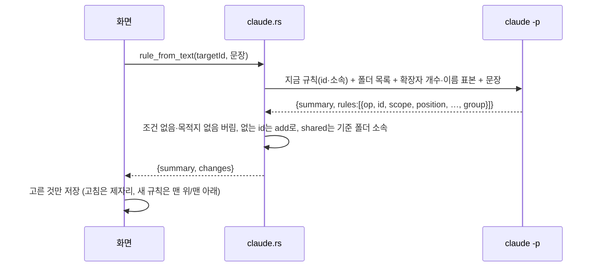
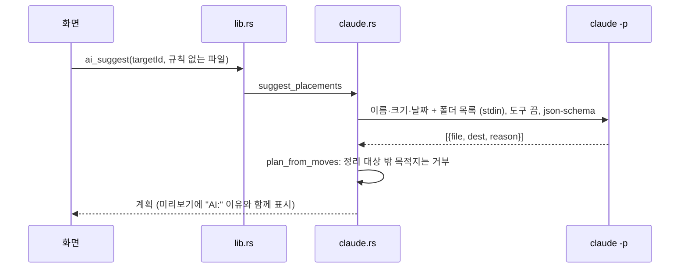

# Smash! 구현도

> 2026-11-05: v1.1.0(Electron) 코드를 보고 정리한 뒤, 2.0.0 Tauri 전환에 맞춰 고쳤다.
> 함께 보기: [기획서](기획서.md) · [설계서](설계서.md) · [결정기록](결정기록.md)

## 폴더 구조

```text
folder-tidy/            (GitHub: ESeungJun/smash)
├── package.json        버전(앱 버전의 원본), Tauri CLI 스크립트
├── src-tauri/          Tauri 앱 (Rust)
│   ├── tauri.conf.json   창 없이 시작(창은 코드에서 만듦), CSP, 번들, 업데이트 공개 키
│   ├── capabilities/     화면 권한: main·nag 창에 core:default만
│   └── src/
│       ├── main.rs       `--mcp`면 MCP 서버, 아니면 앱
│       ├── lib.rs        앱 본체: 창·트레이·명령·등짝 스매시·잔소리 배너·자동 정리 연결·자동 업데이트
│       ├── config.rs     설정 경로·기본 규칙·파일 종류·읽기/쓰기
│       ├── organizer.rs  스캔(하위 폴더·연결 규칙) → 계획 → 실행 → 기록·되돌리기, 폴더 트리, regroup
│       ├── grouping.rs   대분류 안 소분류(기존 폴더·용도 단어·카메라·이름 앞부분·시간 묶음)
│       ├── thumbs.rs     내용 묶기용 썸네일(맥 sips·qlmanage, 윈도우 셸 썸네일)
│       ├── watcher.rs    자동 정리(AutoTidy): notify 감시 + 다 받아질 때까지 대기 (작업 스레드 하나)
│       ├── claude.rs     claude CLI 찾기·호출, 자리 제안, 규칙 세트 제안, 사진·영상 내용 묶기, MCP 등록·옛 등록 교체
│       ├── mcp.rs        stdio MCP 서버(도구 6개)
│       ├── trash.rs      OS 휴지통으로 보내기
│       ├── lang.rs       한국어·영어 문구(l), OS 언어 읽기
│       └── test_util.rs  테스트용 임시 폴더(SMASH_HOME)
├── src/
│   └── renderer/
│       ├── tauri-bridge.js                    window.tidy → Tauri 명령·이벤트
│       ├── index.html · app.js · style.css    본 화면(미리보기·규칙·기록·자동 정리 · Claude 탭)
│       ├── smash.html · smash.js · smash.css  등짝 스매시 효과 창
│       └── nag.html · nag.js · nag.css        자동 정리 잔소리 배너 창
├── assets/             아이콘·트레이 아이콘 원본(svg)과 png
├── build/              icon.png, lproj(화면 이름 Smash!)
├── scripts/
│   ├── build-web.js      src/renderer·assets → dist-web (Tauri가 싣는 화면)
│   └── render-icons.js   svg → png 아이콘 만들기
├── .github/workflows/
│   ├── build.yml         feature·develop push: cargo test(리눅스) + 서명 없는 맥·윈도우 설치 파일
│   └── release.yml       v* 태그: 맥 서명·공증, 윈도우, 업데이트 파일·latest.json, 초안 릴리스
└── docs/               이 문서들, README용 images·video
```

## 주요 흐름

### 정리하기 버튼 (등짝 스매시)


- `hit`과 `done`을 따로 기다린다. 효과 창이 안 닫힌 채 남아도 정리는 1.5초 안에, 창은 3초 안에 끝난다([lib.rs `smash_effect`](../src-tauri/src/lib.rs)).

### 스캔과 계획



### 자동 정리



### Claude로 사진·영상 내용 묶기 (설정에서 켰을 때만)



### Claude로 규칙 세트 만들기



### Claude에 자리 묻기



## 핵심 파일

| 파일 | 설명 |
|---|---|
| [organizer.rs](../src-tauri/src/organizer.rs) | `scan_target`(계획), `apply_plan`(실행·안전장치), `undo_last`, `plan_from_moves`(AI·MCP 계획 검증), `folder_tree`. 한글 비교는 `nfc()` |
| [config.rs](../src-tauri/src/config.rs) | `CATEGORIES`(파일 종류 칩), `default_config`(문서 폴더 기준 기본 규칙), `normalize`(1.x처럼 느슨하게 읽기), `write_json_atomic` |
| [watcher.rs](../src-tauri/src/watcher.rs) | `AutoTidy::sync`가 자동 정리 켠 폴더만 감시. 감시·타이머를 작업 스레드 하나가 맡는다 |
| [organizer.rs](../src-tauri/src/organizer.rs) (추가) | `effective_rules`(자기 규칙 + 기준 폴더 규칙), `scan_files`(하위 폴더), `regroup`(내용 묶기 결과로 다시 계획) |
| [grouping.rs](../src-tauri/src/grouping.rs) | `subfolders(mode, files, existing)`, `PURPOSES`(용도 단어), `clean_folder` |
| [thumbs.rs](../src-tauri/src/thumbs.rs) | `make_thumbs`: 맥 `sips`·`qlmanage`, 윈도우 PowerShell 셸 썸네일 |
| [claude.rs](../src-tauri/src/claude.rs) | `find_claude_cli`, `run_cli`(입력은 따로 스레드로 씀), `suggest_placements`, `rules_proposal`, `group_media_by_content`, `claude_config_locations`, `register_claude_code`, `register_claude_desktop`, `refresh_registrations`(옛 등록 교체) |
| [mcp.rs](../src-tauri/src/mcp.rs) | 줄 단위 JSON-RPC. `initialize`, `tools/list`, `tools/call` |
| [lib.rs](../src-tauri/src/lib.rs) | `smash_effect`, `smash_and_apply`, `tidied_folder`, `show_nag`, 트레이, 업데이트 확인(`UpdateStatus` → `update:state` 이벤트), 명령(`config_get`, `scan`, `apply`, `undo`, `ai_suggest`, `integration_*`, `update_status`·`update_check`·`update_install` 등) |
| [tauri-bridge.js](../src/renderer/tauri-bridge.js) | 1.x의 preload와 같은 `window.tidy`를 Tauri `invoke`·`listen`으로 만든다 |
| 각 `.rs`의 `#[cfg(test)]` | 1.x Node 테스트를 옮긴 것. `SMASH_HOME`을 임시 폴더로 두고 정리·MCP·AutoTidy를 검증 |

## 빌드·실행·배포

```bash
npm install
npm run dev        # 앱 실행 (Rust 필요)
npm test           # build-web 후 cargo test -- --test-threads=1
npm run build      # 이 컴퓨터용 설치 파일
npm run icons      # assets/*.svg → build/icon.png, 트레이 아이콘
src-tauri/target/release/smash --mcp   # MCP 서버만 띄우기
```

- 2026-11-06부터 이 맥에 Rust가 있다. `feature/*`를 push하면 `build.yml`이 리눅스에서 `cargo test`를 돌리고, 맥(유니버설)·윈도우 설치 파일을 artifact로 남긴다.
- 로컬 화면 확인: `npm run dev`는 창이 빈 화면으로 뜬다(2026-11-06 확인, 원인 미조사). 대신 `npx tauri build --debug --no-bundle` 뒤 `SMASH_HOME=<임시 폴더> src-tauri/target/debug/smash`로 띄운다. 설치된 Smash가 켜져 있으면 중복 실행 방지로 넘어가니 먼저 끈다.
- `productName`은 영문 `Smash`로 둔다. 화면 이름 `Smash!`는 `build/lproj`가 맡는다.
- 설치본을 확인할 때는 30초 넘게 띄워 두고 크래시 리포트까지 본다.
- 배포: `package.json` 버전을 올리고 `vX.Y.Z` 태그를 push하면 `release.yml`이 초안 릴리스를 만든다. GitHub에서 Publish해야 공개되고, 그때부터 설치된 앱들이 업데이트를 받는다.
  - 올라가는 파일: `Smash-macOS.dmg`(유니버설, 서명·공증), 같은 파일의 1.x 이름 `Smash-macOS-arm64.dmg`·`Smash-macOS-x64.dmg`, `Smash-Windows-x64-Setup.exe`, `Smash-macOS.app.tar.gz`, `latest.json`, `SHA256SUMS`.
  - 저장소 Secrets: `MAC_CERT_P12`, `MAC_CERT_PASSWORD`, `APPLE_API_KEY_P8`, `APPLE_API_KEY_ID`, `APPLE_API_ISSUER`, `TAURI_SIGNING_PRIVATE_KEY`(`~/.tauri/smash.key`), `TAURI_SIGNING_PRIVATE_KEY_PASSWORD`.
- 깃 흐름(git flow, 도구 없이 수동): `main`은 릴리스만, `develop`이 기본 작업 브랜치, 기능은 `feature/*`, 릴리스는 `release/x.y.z`에서 버전을 올려 `main`에 합치고 `vX.Y.Z` 태그. 개발 중에는 버전을 올리지 않는다.

## 버전·릴리스 현황

| 태그 | 날짜 | 내용 |
|---|---|---|
| v1.0.0 | 2026-11-02 | 첫 공개. 규칙·트리 미리보기·자동 정리·잔소리 배너·등짝 스매시·Claude CLI·MCP |
| v1.1.0 | 2026-11-02 | 화면 언어 설정(한국어·영어). MCP 서버도 앱에서 고른 언어로 답함 |
| v2.0.0 | 2026-11-05 | Electron → Tauri 2. 맥 서명·공증, 자동 업데이트, 유니버설 dmg, MCP는 `smash --mcp` |
| v2.1.0 | 2026-11-05 | 설정 탭 앱 정보 카드(버전·업데이트 확인·설치), 트레이 버전 줄과 "업데이트 확인…", 새 버전 알림 |

- 공개 전 개발은 2026-11-01 23시 첫 커밋부터 시작해 v1.1.0까지 약 13시간 걸렸다(개발 글 기준). 공개할 때 히스토리를 한 커밋(`cc2a20e`)으로 새로 만들었다.

## 앞으로 할 일

- [x] 소분류(자동·연월), 하위 폴더까지 정리, 폴더 연결, Claude 규칙 세트, 사진·영상 내용 묶기, 사이드바 폴더 빼기, X 누르면 트레이로 (다음 버전, `feature/smart-organize`)
- [ ] Windows에서 셸 썸네일·트레이 숨김 실기기 확인

- [x] macOS 코드 서명·공증 (2.0.0)
- [ ] Windows 코드 서명
- [ ] Windows 실기기 테스트
- [x] Tauri로 옮기기 (2.0.0)
