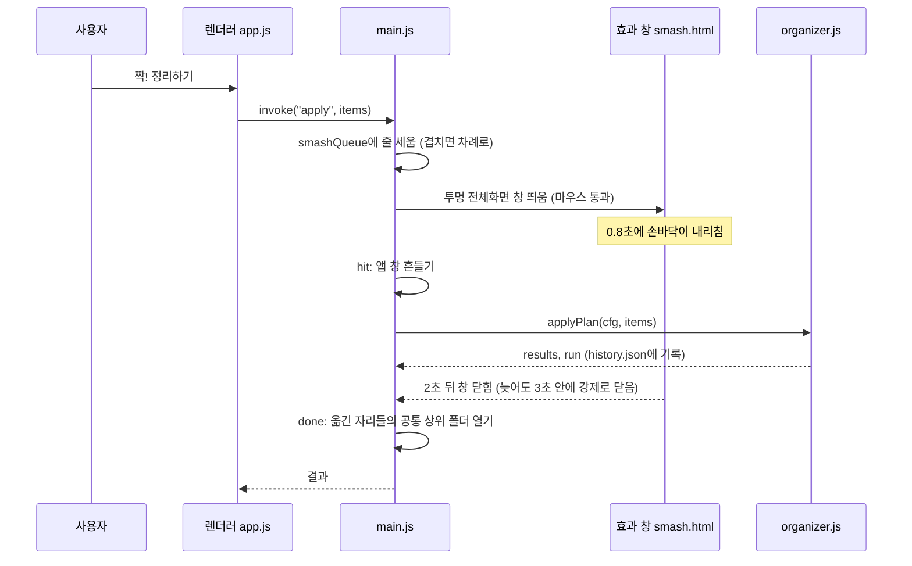
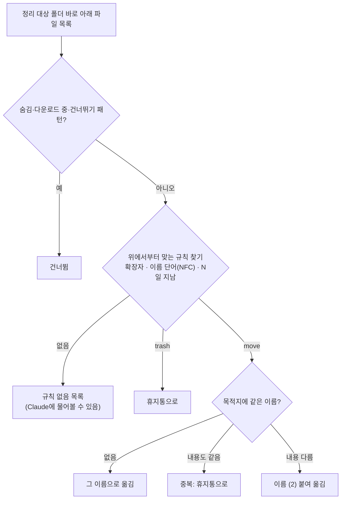
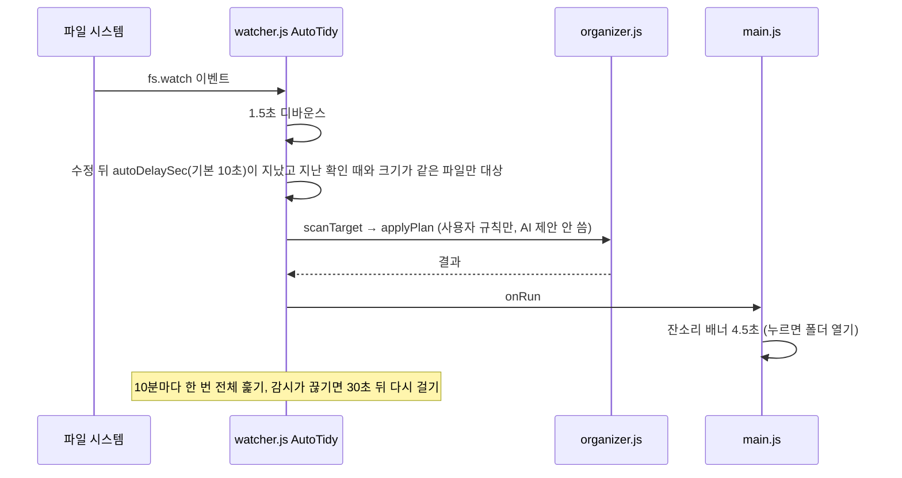
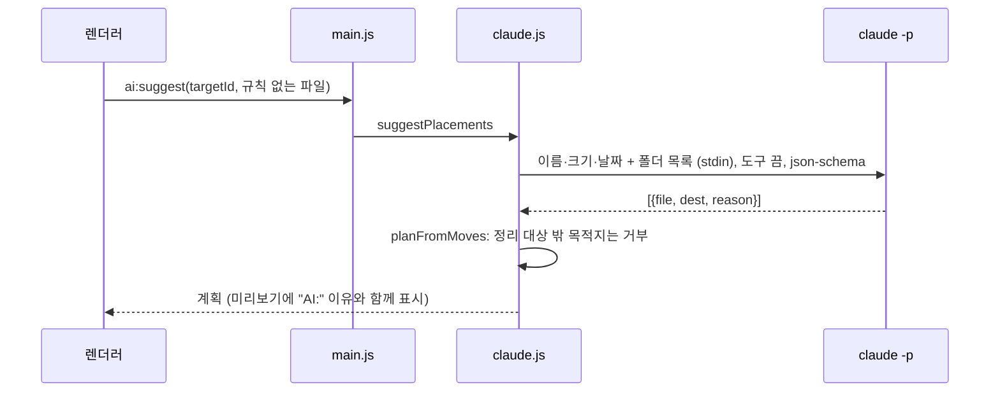

# Smash! 구현도

> 2026-11-05에 v1.1.0 코드를 보고 정리했다.
> 함께 보기: [기획서](기획서.md) · [설계서](설계서.md) · [결정기록](결정기록.md)

## 폴더 구조

```text
folder-tidy/            (GitHub: ESeungJun/smash)
├── package.json        스크립트, electron-builder 설정
├── src/
│   ├── main.js         메인 프로세스: 창·트레이·IPC·등짝 스매시·잔소리 배너·자동 정리 연결
│   ├── preload.js      렌더러에 IPC만 노출(contextBridge)
│   ├── core/           GUI와 MCP 서버가 같이 쓰는 로직 (asar 밖으로 풀림)
│   │   ├── config.js     설정 경로·기본 규칙·파일 종류·읽기/쓰기
│   │   ├── organizer.js  스캔 → 계획 → 실행 → 기록·되돌리기, 폴더 트리
│   │   ├── watcher.js    자동 정리(AutoTidy): fs.watch + 다 받아질 때까지 대기
│   │   ├── claude.js     claude CLI 찾기·호출, 자리 제안, 말로 규칙, MCP 등록
│   │   ├── trash.js      OS 휴지통으로 보내기
│   │   └── lang.js       한국어·영어 문구(L), OS 언어 읽기
│   ├── mcp/server.js   stdio MCP 서버(도구 6개)
│   └── renderer/
│       ├── index.html · app.js · style.css    본 화면(미리보기·규칙·기록·자동 정리 · Claude 탭)
│       ├── smash.html · smash.js · smash.css  등짝 스매시 효과 창
│       └── nag.html · nag.js · nag.css        자동 정리 잔소리 배너 창
├── assets/             아이콘·트레이 아이콘 원본(svg)과 png
├── build/              icon.png, lproj(화면 이름 Smash!)
├── scripts/render-icons.js  svg → png 아이콘 만들기
├── test/core.test.js   Node 내장 테스트
└── docs/               이 문서들, README용 images·video
```

## 주요 흐름

### 정리하기 버튼 (등짝 스매시)



- `hit`과 `done`을 따로 기다린다. 효과 창이 안 닫힌 채 남아도 정리는 1.5초 안에, 창은 3초 안에 끝난다([main.js `smashEffect`](../src/main.js)).

### 스캔과 계획



### 자동 정리



### Claude에 자리 묻기



## 핵심 파일

| 파일 | 설명 |
|---|---|
| [src/core/organizer.js](../src/core/organizer.js) | `scanTarget`(계획), `applyPlan`(실행·안전장치), `undoLast`, `planFromMoves`(AI·MCP 계획 검증), `folderTree`. 한글 비교는 `nfc()` |
| [src/core/config.js](../src/core/config.js) | `CATEGORIES`(파일 종류 칩), `defaultConfig`(문서 폴더 기준 기본 규칙), `normalize`, `writeJsonAtomic` |
| [src/core/watcher.js](../src/core/watcher.js) | `AutoTidy.sync`가 자동 정리 켠 폴더만 감시 |
| [src/core/claude.js](../src/core/claude.js) | `findClaudeCli`, `runCli`, `suggestPlacements`, `ruleFromText`, `claudeConfigLocations`, `registerClaudeCode`, `registerClaudeDesktop` |
| [src/mcp/server.js](../src/mcp/server.js) | 줄 단위 JSON-RPC. `initialize`, `tools/list`, `tools/call` |
| [src/main.js](../src/main.js) | `mcpLaunch`, `smashEffect`, `smashAndApply`, `tidiedFolder`, `showNag`, IPC 핸들러(`config:*`, `scan`, `apply`, `undo`, `ai:suggest`, `integration:*` 등) |
| [test/core.test.js](../test/core.test.js) | `SMASH_HOME`을 임시 폴더로 두고 core·MCP·AutoTidy를 검증 |

## 빌드·실행·배포

```bash
npm install
npm start          # 앱 실행
npm test           # node --test test/*.test.js
npm run mcp        # MCP 서버만 띄우기 (ELECTRON_RUN_AS_NODE=1)
npm run icons      # assets/*.svg → build/icon.png, 트레이 아이콘
npm run dist:mac   # dist/Smash-macOS-arm64.dmg, dist/Smash-macOS-x64.dmg
npm run dist:win   # dist/Smash-Windows-x64-Setup.exe (macOS에서도 빌드됨)
```

- 빌드 `productName`은 영문 `Smash`로 둔다. 실행 파일과 Helper 앱 이름이 이걸 따라가는데, 둘이 어긋나면 "Unable to find helper app"으로 앱이 켜진 뒤 바로 죽는다. 화면 이름 `Smash!`는 `build/lproj`와 `app.setName`이 맡는다.
- 설치본을 확인할 때는 30초 넘게 띄워 두고 크래시 리포트까지 본다.
- 배포: `dist/`의 dmg 두 개와 exe를 GitHub 릴리스에 올린다. 파일 이름에 버전을 넣지 않아 README의 `releases/latest/download/` 링크가 늘 최신을 가리킨다.
- 깃 흐름(git flow, 도구 없이 수동): `main`은 릴리스만, `develop`이 기본 작업 브랜치, 기능은 `feature/*`, 릴리스는 `release/x.y.z`에서 버전을 올려 `main`에 합치고 `vX.Y.Z` 태그. 개발 중에는 버전을 올리지 않는다.

## 버전·릴리스 현황

| 태그 | 날짜 | 내용 |
|---|---|---|
| v1.0.0 | 2026-11-02 | 첫 공개. 규칙·트리 미리보기·자동 정리·잔소리 배너·등짝 스매시·Claude CLI·MCP |
| v1.1.0 | 2026-11-02 | 화면 언어 설정(한국어·영어). MCP 서버도 앱에서 고른 언어로 답함 |

- 공개 전 개발은 2026-11-01 23시 첫 커밋부터 시작해 v1.1.0까지 약 13시간 걸렸다(개발 글 기준). 공개할 때 히스토리를 한 커밋(`cc2a20e`)으로 새로 만들었다.

## 앞으로 할 일

- [ ] macOS 코드 서명·공증, Windows 코드 서명
- [ ] Windows 실기기 테스트
- [ ] Tauri 판 검토(개발 글에서 "다음 기회에"로 남김)
