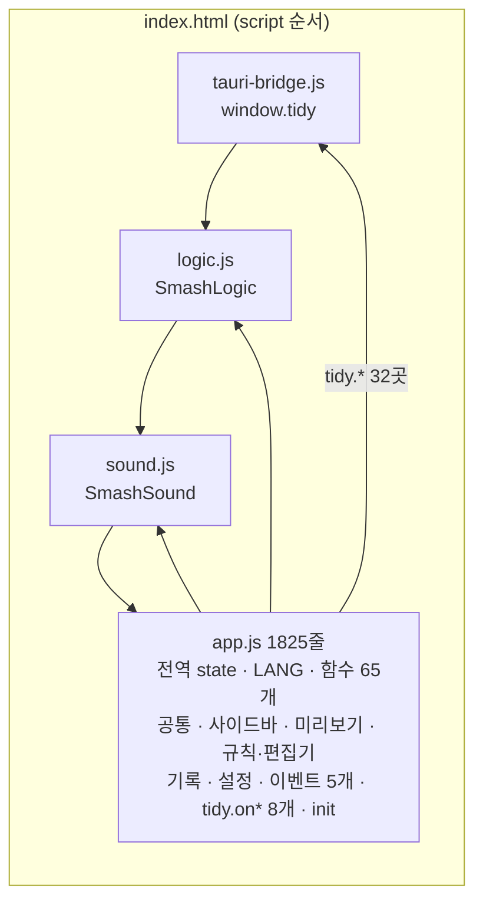
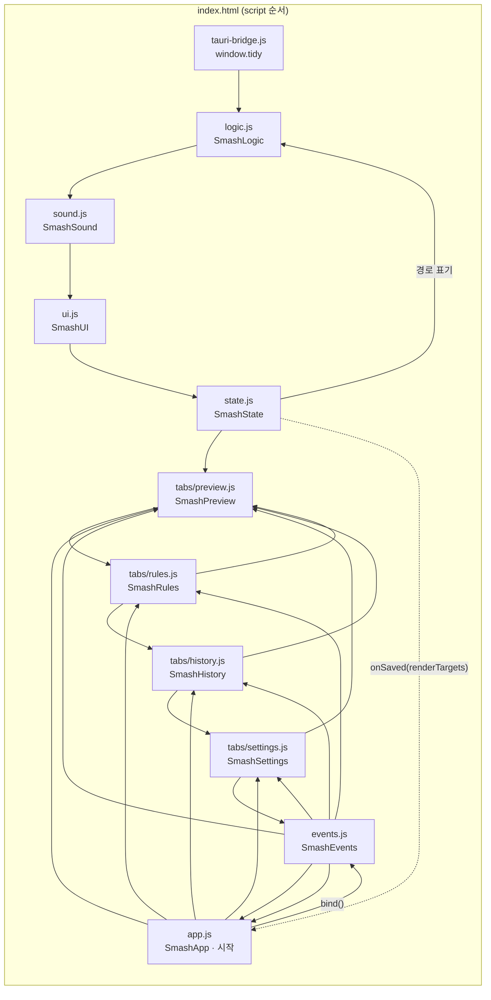

# 리팩토링: 본 화면 스크립트(app.js) 나누기

> 2026-11-17 · 이슈 [#1](https://github.com/ESeungJun/smash/issues/1) · 브랜치 `feature/1-split-renderer-app`
> 함께 보기: [구현도](../구현도.md) · [설계서](../설계서.md)

원칙: 화면에 보이는 것, 누르면 일어나는 일, Tauri로 보내는 명령과 인자는 **하나도 바꾸지 않는다**. Rust 쪽은 건드리지 않는다.

## 1. 왜 해야 하나

- `src/renderer/app.js` 한 파일이 **1825줄, 함수 65개, 맨 위 선언 93개**다. 네 탭(미리보기·규칙·기록·설정)의 그리기, Tauri 명령 호출 32곳, 문서 전체에 건 위임 이벤트 처리기 다섯 개를 모두 맡는다.
- 탭 하나를 고칠 때도 파일 전체를 훑어야 한다. 특히 `click`(≈85줄)·`change`(≈100줄) 처리기에 네 탭의 분기가 한 줄로 섞여 있어서, 규칙 탭 버튼 하나를 더해도 설정 탭 분기 사이를 지나가야 한다.
- 맨 위 선언 93개가 모두 전역(`window`·전역 렉시컬)이라 어떤 함수를 누가 부르는지 이름을 검색하기 전에는 모른다.
- 경로 표기 계산(`destText`·`expand`·`contract`)이 DOM·전역 `state`에 붙어 있어 `node --test`로 시험할 수 없다. `destText`는 `SmashLogic.resolvePath`와 비슷한 절대 경로 판단을 따로 갖고 있다.
- 안 하면: 탭을 고칠 때마다 다른 탭을 깨뜨릴 위험, 리뷰 때 diff가 한 파일에 몰려 읽기 어려움, 경로 표기 버그(아래 "발견한 문제")를 테스트로 잡을 수 없음.

## 2. 전·후 비교

| 항목 | 전 | 후 |
|---|---|---|
| 본 화면 스크립트 | `app.js` 1개, 1825줄 | 8개: `ui.js`·`state.js`·`tabs/preview.js`·`tabs/rules.js`·`tabs/history.js`·`tabs/settings.js`·`events.js`·`app.js` |
| 가장 큰 파일 | `app.js` 1825줄 | `tabs/rules.js` (실측은 9절) |
| 전역 이름 | 맨 위 선언 93개가 모두 전역 | 이름공간 7개(`SmashUI`·`SmashState`·`SmashPreview`·`SmashRules`·`SmashHistory`·`SmashSettings`·`SmashEvents`)와 `SmashApp`. `SmashLogic`과 같은 꼴 |
| 의존 방향 | 한 파일 안에서 서로 자유롭게 부름 | `ui → state → 탭 → events → app` 한 방향. 위 단계는 아래 단계를 부르지 않는다(저장 뒤 사이드바 다시 그리기만 `onSaved` 콜백으로 거꾸로 알린다) |
| 이벤트 처리 | 처리기 안에 상태 바꾸기·저장·다시 그리기가 직접 섞임 | `events.js`는 어느 요소인지 보고 탭 모듈 함수로 넘기기만 한다. 분기 순서는 그대로 |
| 경로 표기 | `app.js` 안 `destText`·`expand`·`contract`(시험 불가) | `logic.js`의 `destLabel`·`toNativePath`·`contractPath`·`baseName`, `node --test`로 고정 |
| 테스트 | `node --test` 8개 | 11개(경로 표기 특성 테스트 3개 추가) + 화면 DOM 대조 하네스(아래 4절, 저장소에는 넣지 않음) |
| 스크립트 싣기 | 번들러 없음, `<script>` 4개 | 번들러 없음, `<script>` 11개. `build-web.js`가 `src/renderer`를 통째로 복사하므로 빌드·CSP(`script-src 'self'`)는 그대로 |

## 3. 전·후 설계도

### 전

### 후

- 화살표는 "부른다". 점선은 `app.js`가 시작할 때 넘겨 둔 콜백이다(저장할 때마다 사이드바를 다시 그리는 원래 동작을 그대로 두면서, `state.js`가 사이드바를 직접 알지 않게).
- 모든 파일이 `tidy`(Tauri)를 직접 부를 수 있다. 명령 이름·인자·부르는 순서는 그대로다.

### 파일별로 맡는 것

| 파일 | 이름공간 | 맡는 것 |
|---|---|---|
| `ui.js` | `SmashUI` | `$`, 화면 언어(`L`, `setLang`, `getLang`), `esc`, `toast`, `fmtSize`, 아이콘, 스위치·상태 줄 HTML, `reducedMotion` |
| `state.js` | `SmashState` | 전역 `state` 하나, 설정 읽기·저장·합치기(`adoptConfig`, `saveConfig`, `onSaved`), 경로 도우미(`expand`·`contract`·`destText`·`destInside` 등), 폴더 목록(`loadFolders`) |
| `tabs/preview.js` | `SmashPreview` | 스캔, 트리 그리기, 막힌 파일·결과·처음 안내, Claude 자리 묻기·내용 묶기, 정리 실행과 타격 효과, 체크·접기 |
| `tabs/rules.js` | `SmashRules` | 규칙 카드·문장, 편집기(초안·태그·칩), 말로 규칙 만들기·제안 저장, 폴더 카드(하위 폴더·연결), "목록에서 빼기" 버튼 글자 |
| `tabs/history.js` | `SmashHistory` | 기록 그리기, 되돌리기 |
| `tabs/settings.js` | `SmashSettings` | 설정 카드, Claude 연결 상태·등록, 업데이트 카드, 자동 정리 켜기 전 확인 |
| `events.js` | `SmashEvents` | 문서에 거는 `click`·`mousedown`·`keydown`·`input`·`change`와 `tidy.on*` 구독. 어느 요소인지 보고 위 모듈로 넘긴다 |
| `app.js` | `SmashApp` | 사이드바 폴더 목록(그리기·고르기·더하기·빼기), 탭 전환, 고정 문구 번역, 시작(`init`) |

## 4. 단계별 계획

동작이 같은지는 **화면 DOM 대조 하네스**로 본다(저장소 밖 `.work/harness/`, 커밋하지 않음).

- 가짜 `window.__TAURI__`가 늘 같은 설정·스캔·기록·연결 상태를 주고 `Date.now`·`Math.random`을 고정한다.
- 시나리오가 98단계를 차례로 누른다: 규칙 편집기 칩·태그·기간·목적지(상대·절대·밖)·저장·수정·취소, 규칙 켜기·순서·삭제, 말로 만들기·제안 고르기·저장, 폴더 연결·하위 폴더, 미리보기 체크·접기·처음 안내·Claude 자리 묻기·내용 묶기·정리하기·타격·진행·결과 닫기·막힌 폴더 추가, 기록 되돌리기, 설정 스위치·자동 정리 확인·모델·등록·업데이트, 사이드바 고르기·빼기·추가, 밖에서 오는 이벤트(`config:changed`·`ui:tab`·`auto:ran`·`auto:confirm`·`ui:target`·`update:state`).
- 단계마다 `body` HTML 전체, 모든 입력·버튼의 값·체크·사용 가능 여부, 포커스, `state` 전체, 지금까지의 Tauri 호출 수를 모으고, 끝에 Tauri 호출 목록(명령·인자)을 모은다.
- 한국어·맥(`/`)과 영어·윈도우(`\`) 두 벌을 돌린다. 리팩토링 전 코드로 두 번 돌려 결과가 글자 그대로 같은 것(흔들림 없음)을 먼저 확인했다.

| 단계 | 옮기는 것 | 끝의 확인 |
|---|---|---|
| 1 | 경로 표기 특성 테스트 + `logic.js`에 같은 동작의 순수 함수 | `node --test` |
| 2 | `ui.js`·`state.js` 분리, `app.js`의 경로 계산을 `SmashLogic`으로 | `node --test`, DOM 대조 두 벌, 콘솔 오류 없음 |
| 3 | 미리보기·기록 탭을 `tabs/`로 | 같음 |
| 4 | 규칙·설정 탭을 `tabs/`로 | 같음 |
| 5 | 이벤트 처리기를 `events.js`로, `app.js`는 사이드바·탭 전환·시작만 | 같음 + 네 탭 스크린샷 전·후 |
| 6 | `docs/구현도.md`를 후 기준으로, 이 문서에 실측 | — |

- 단계마다 커밋한다(되돌리기 지점). 같은 단계에서 3번 실패하면 멈춘다.

## 5. 영향 범위

- 내부(바뀌는 파일): `src/renderer/app.js`, `src/renderer/index.html`(script 태그), `src/renderer/logic.js`(함수 추가), 새 파일 `ui.js`·`state.js`·`events.js`·`tabs/*.js`, `test/logic.test.js`, `docs/구현도.md`.
- 외부: 없음. `tauri-bridge.js`의 `window.tidy`, Rust 명령 이름·인자, 설정 파일 형식, 효과 창(`smash.html`)·잔소리 배너(`nag.html`)는 그대로다. `lib.rs`가 화면에 `eval`하는 것은 효과 창의 `window.smashMiss` 하나뿐이라 본 화면 전역 이름이 없어져도 상관없다.
- 빌드·설정: `scripts/build-web.js`가 `src/renderer`를 통째로 복사하므로 `tabs/` 폴더도 따라간다. `tauri.conf.json`의 CSP는 `script-src 'self'`라 같은 출처 파일이 늘어도 바꿀 것이 없다.

## 6. 리스크와 되돌리는 법

| 리스크 | 막는 법 |
|---|---|
| 전역 함수 이름을 다른 스크립트가 쓰고 있었다 | 저장소 검색: `smash.js`·`nag.js`는 다른 창이고, Rust `eval`은 `smashMiss`만 부른다 |
| script 순서가 바뀌어 아직 없는 이름공간을 부른다 | 아래 단계 이름공간만 파일을 읽을 때 꺼내 쓰고, `app.js`가 맨 마지막에 `SmashEvents.bind()` → `init()` 순서로 원래처럼 처리기를 먼저 건다 |
| 이벤트 분기 순서가 바뀌어 다른 처리기가 먼저 잡는다(예: 편집기 열린 채 `data-group`) | `events.js`의 `if` 순서를 원래와 같게 두고, DOM 대조로 확인 |
| 경로 표기가 미묘하게 달라진다 | 특성 테스트 + 원래 함수와 새 함수를 무작위 입력 8만 개로 대조(불일치 0) |
| 되돌리기 | 단계별 커밋이라 `git revert <커밋>` 한 번. 전체는 PR을 머지하지 않거나 머지 커밋을 revert |

## 7. 기대 효과 (측정할 것)

- `app.js` 1825줄 → 250줄 안팎, 가장 큰 파일 650줄 안팎
- 전역 이름 93개 → 이름공간 8개
- 경로 표기 계산을 `node --test`로 고정(테스트 8 → 11)
- 탭 하나를 고칠 때 읽을 파일이 그 탭 파일 + `events.js`의 해당 분기로 줄어듦

## 8. 발견한 문제 (이번에 고치지 않음)

동작을 바꾸지 않는 리팩토링이라 아래는 그대로 두고 따로 이슈로 남긴다.

1. **규칙 목적지 표기가 `..`·`.`·끝 `/`를 정리하지 않는다.** 목적지 `../Archive`는 규칙 카드에 `Downloads/../Archive`로 보이는데, 실제 이동(Rust `config::resolve`)과 "정리할 폴더 밖" 판정(`destInsideTargets`)은 `~/Archive`로 본다. 그래서 "Downloads 안"처럼 읽히는 글자 옆에 "정리할 폴더 밖" 꼬리표가 같이 붙는다. 편집기의 "새 폴더로 만들어요" 판정(`state.folders`와 표기 글자 비교)도 같은 이유로 `자료/`처럼 끝에 `/`가 있으면 이미 있는 폴더를 새 폴더로 본다. `destText`를 `resolvePath`로 바꾸면 고쳐지지만 보이는 글자가 바뀌므로 버그 수정으로 따로 한다. 테스트 `규칙 목적지 표기는 resolvePath 로 바꿀 수 없다`가 지금 차이를 고정해 두었다.
2. **`\`로 시작하는 목적지**를 `destText`는 상대 경로로, `isAbsolute`·`resolvePath`는 절대 경로로 본다(윈도우에서 `\x`가 `Downloads//x`로 보임). 1과 같이 고친다.
3. **JS `destInsideTargets`(logic.js)와 Rust `rule_dest_inside`(organizer.rs)가 같은 판정을 두 번 구현한다.** 지금은 둘 다 `resolve` 규칙이 같아 결과가 같지만, 한쪽만 고치면 화면 경고와 실제 실행이 어긋난다. 화면이 스캔 결과에 실린 판정을 쓰게 하거나, 양쪽 테스트에 같은 표를 두는 방안을 백로그로 남긴다.
4. **`fmtSize`(app, 1024 단위·소수 한 자리)와 `SmashLogic.fmtBytes`(1000 단위)가 크기 표기를 두 가지로 한다.** 미리보기와 기록 탭의 숫자 단위가 다르다. 합치면 보이는 숫자가 바뀌므로 그대로 두었다.
5. `state.struckIds`는 `state` 처음 모양에 없고 `doApply`에서만 생긴다. 동작 문제는 없어 그대로 두었다.

## 9. 실측 결과

(구현 뒤 채운다)
