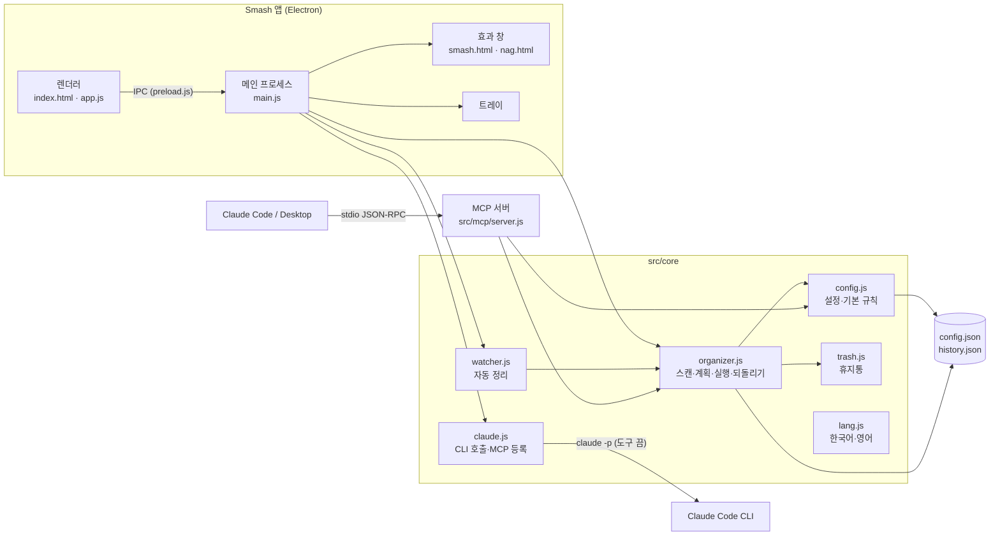

# Smash! 설계서

> 2026-11-05에 v1.1.0 코드를 보고 정리했다.
> 함께 보기: [기획서](기획서.md) · [구현도](구현도.md) · [결정기록](결정기록.md)

## 기술 스택

| 영역 | 고른 것 | 이유 |
|---|---|---|
| 앱 틀 | Electron 45 | 개발 기기가 Intel Mac이고 Rust가 안 깔려 있어 Tauri를 미뤘다. 같은 실행 파일로 MCP 서버까지 돌릴 수 있다 |
| 화면 | 프레임워크 없는 순수 HTML·CSS·JS | 화면이 탭 몇 개라 빌드 단계 없이 간다 |
| 언어 | CommonJS JavaScript | Electron 메인·MCP 서버·테스트가 같은 `src/core` 모듈을 그대로 `require` 한다 |
| 테스트 | Node 내장 테스트 러너(`node --test`) | 의존성 없이 규칙 엔진·MCP·자동 정리를 검증 |
| 패키징 | electron-builder 26 | dmg(arm64·x64)와 NSIS exe를 한 설정으로 만든다 |
| AI 연동 | `claude -p` CLI, stdio MCP | API 키 없이 사용자 PC에 로그인된 Claude를 쓴다 |

### 앱 틀 후보 비교

개발 글과 프로젝트 메모리에 남은 근거만 적는다. 웹 검색 비교는 하지 않았다(기록 없음).

| 후보 | 장점 | 걸린 점 | 결과 |
|---|---|---|---|
| Tauri | 앱이 가볍다 | 이 맥에 Rust가 없었다 | 다음 기회로 미룸 |
| Electron | 바로 만들 수 있다. 앱 실행 파일을 `ELECTRON_RUN_AS_NODE=1`로 돌리면 사용자가 Node를 따로 안 깔아도 MCP 서버가 뜬다 | 앱이 무겁다 | 고름 |

## 전체 아키텍처

GUI와 MCP 서버가 같은 core 모듈과 같은 설정·기록 파일을 쓴다. 그래서 앱에서 만든 규칙으로 Claude도 정리하고, Claude가 한 정리도 앱에서 되돌린다.



- MCP 서버는 앱 실행 파일 자체를 Node처럼 띄운다: `command = process.execPath`, `env = ELECTRON_RUN_AS_NODE=1`, 스크립트는 패키징 뒤 `app.asar.unpacked/src/mcp/server.js`([main.js `mcpLaunch`](../src/main.js)).
- 이를 위해 `src/core/**`, `src/mcp/**`는 asar 밖으로 푼다(`package.json` `asarUnpack`).

## 데이터 구조

### 설정 파일 `config.json`

| 위치 | 경로 |
|---|---|
| macOS | `~/Library/Application Support/Smash/config.json` |
| Windows | `%APPDATA%\Smash\config.json` |
| 그 밖 | `$XDG_CONFIG_HOME/smash/config.json` |
| 테스트 | `SMASH_HOME` 환경 변수로 바꿈 |

```json
{
  "version": 2,
  "targets": [
    {
      "id": "downloads",
      "path": "~/Downloads",
      "auto": false,
      "rules": [
        {
          "id": "r_...",
          "name": "사진·이미지",
          "enabled": true,
          "match": { "extensions": ["jpg", "png"], "nameIncludes": [], "olderThanDays": 0 },
          "action": "move",
          "dest": "~/Documents/사진·이미지"
        }
      ]
    }
  ],
  "skip": { "hidden": true, "patterns": ["*.crdownload", "*.part", "..."] },
  "ai": { "model": "sonnet" },
  "settings": { "autoDelaySec": 10, "notify": true, "openAtLogin": false, "smash": true, "openAfter": true, "language": "system" }
}
```

- 규칙은 정리 대상 폴더(`targets`)마다 따로 있고, 위에서부터 처음 맞는 규칙 하나만 적용한다.
- 조건이 하나도 없는 규칙은 아무 파일도 잡지 않는다(실수로 전부 옮기는 것을 막음).
- `normalize`가 읽을 때마다 값을 정리한다: `autoDelaySec`은 3~3600초, 확장자는 소문자·점 제거, `action`은 `move`/`trash`만.
- 쓰기는 임시 파일에 쓰고 `rename` 하는 방식(`writeJsonAtomic`)이라 GUI와 MCP 서버가 동시에 써도 반쯤 쓴 파일이 남지 않는다.

### 기록 파일 `history.json`

- 정리 한 번이 `run` 하나: `{ id, at, source: "app" | "auto" | "claude-mcp", ops: [{ type: "move", from, to } | { type: "trash", from }], undone }`.
- 최근 50건만 둔다(`HISTORY_LIMIT`).
- 되돌리기는 가장 최근의 안 되돌린 `run`에서 `move`만 원래 자리로 돌린다. 휴지통으로 간 파일은 휴지통에서 직접 꺼내야 한다.

### 외부 연동

| 대상 | 방식 | 보내는 것 |
|---|---|---|
| Claude Code CLI | `claude -p --output-format json --tools "" --no-session-persistence --strict-mcp-config --setting-sources ""`, 가능하면 `--json-schema` | 파일 이름·크기·날짜, 폴더 목록. 파일 내용은 안 보냄 |
| Claude Code 설정 | `claude mcp add`로 등록. 기본 `~/.claude.json`, Orca 프로필, `CLAUDE_CONFIG_DIR` 위치를 찾아 고른 곳에 등록 | MCP 실행 명령 |
| Claude Desktop 설정 | `claude_desktop_config.json`을 `.bak`으로 백업한 뒤 `mcpServers.smash` 추가 | MCP 실행 명령 |

### MCP 도구

| 도구 | 하는 일 |
|---|---|
| `list_targets` | 정리 대상 폴더와 규칙 목록 |
| `scan_folder` | 한 폴더를 규칙대로 훑어 계획을 돌려줌(옮기지 않음) |
| `apply_plan` | 계획을 실행. 앱과 같은 안전장치를 거친다 |
| `add_rule` | 규칙 추가. 조건이 하나 이상 있어야 한다 |
| `undo_last` | 마지막 정리 되돌리기 |
| `history` | 정리 기록 |

## 플랫폼별 차이

| 항목 | macOS | Windows | Linux(코드만) |
|---|---|---|---|
| 휴지통 | `osascript -l JavaScript`로 `NSFileManager.trashItemAtURL` 호출(Finder 자동화 권한 불필요) | PowerShell에서 `Microsoft.VisualBasic.FileIO.FileSystem.DeleteFile(..., SendToRecycleBin)` | `~/.local/share/Trash`에 직접 옮기고 `.trashinfo` 작성 |
| 트레이 | 메뉴 막대, 템플릿 아이콘(`trayTemplate.png`) | 알림 영역, 컬러 아이콘(`tray-color.png`) | - |
| 앱 이름 | 번들·실행 파일 `Smash`, 화면 이름 `Smash!`는 `build/lproj/*/InfoPlist.strings` | NSIS 바로가기 이름 `Smash!`, `AppUserModelId` `dev.haul.smash` | - |
| 한글 파일 이름 | 파일 시스템이 NFD로 돌려주므로 NFC로 맞춰 비교 | 해당 없음 | 해당 없음 |
| `claude` CLI | 실행 파일 직접 실행 | npm 설치본 `claude.cmd`는 셸을 거쳐 실행, 이때 `--json-schema`는 빼고 텍스트 JSON을 해석 | - |
| OS 언어 | MCP 서버(Node로 실행)는 `defaults read -g AppleLanguages`로 읽는다. 앱은 `app.getLocale()` | Node 로캘 | Node 로캘 |

## 보안·권한

- 렌더러는 `contextIsolation: true`, `nodeIntegration: false`, `sandbox: true`. 메인과는 `preload.js`가 노출한 IPC만 쓴다.
- 모든 화면에 CSP가 있다. 인라인 style도 막혀서 동적 스타일은 data 속성과 클래스로 처리한다.
- 효과·배너 창은 `will-navigate`를 막고 `setWindowOpenHandler`로 새 창을 거부한다. 효과 창은 마우스를 통과시킨다(`setIgnoreMouseEvents`).
- 파일 작업 안전장치([`applyPlan`](../src/core/organizer.js)):
  - 원본과 목적지가 모두 등록한 정리 대상 폴더 안이어야 한다. 밖이면 거부(MCP로 들어온 요청도 같다).
  - 실행 직전에 목적지를 다시 계산해서 그사이 같은 이름이 생겼으면 덮어쓰지 않고 이름을 바꾼다.
  - 중복으로 버리기로 한 파일은 원본이 아직 같은 내용으로 있을 때만 버린다. 아니면 원본 자리로 옮긴다.
  - 디스크가 다르면(`EXDEV`) 복사(`COPYFILE_EXCL`) 후 원본 삭제.
- Claude에는 파일 내용을 보내지 않는다. CLI는 도구를 모두 끄고(`--tools ""`), 세션을 남기지 않고, 사용자의 다른 MCP·설정을 읽지 않게 띄운다.
- macOS 권한: 다운로드·문서 폴더 접근은 OS가 처음 접근할 때 묻는다. 앱이 따로 권한을 요청하는 코드는 없다.

## 알려진 한계

- 코드 서명·공증이 없어 첫 실행 때 OS가 막는다. 시스템 알림도 서명 안 된 앱에서는 안 뜰 때가 있어 잔소리 배너를 직접 그렸다.
- Windows는 실기기에서 테스트하지 않았다.
- 휴지통으로 보낸 파일은 되돌리기로 복구하지 않는다.
- 스캔은 폴더 바로 아래 파일만 본다. 하위 폴더 속 파일은 정리하지 않는다.
- 자동 정리는 `fs.watch` 이벤트와 10분마다 한 번 훑기로 동작한다. 감시가 끊기면 30초 뒤 다시 건다.
- Claude 자리 묻기는 한 번에 파일 200개까지만 보낸다(`MAX_FILES_PER_REQUEST`, [claude.js](../src/core/claude.js)).
