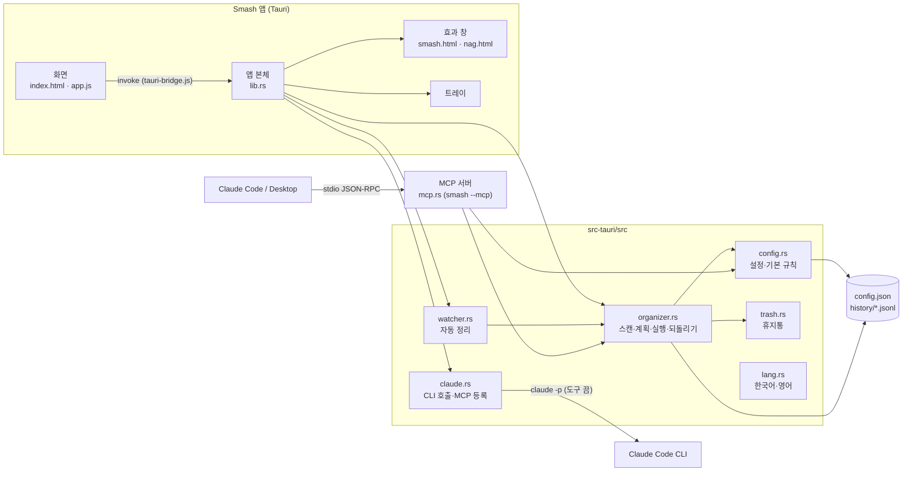

# Smash! 설계서

> 2026-11-05: v1.1.0(Electron) 코드를 보고 정리한 뒤, 2.0.0 Tauri 전환에 맞춰 고쳤다.
> 함께 보기: [기획서](기획서.md) · [구현도](구현도.md) · [결정기록](결정기록.md)

## 기술 스택

| 영역 | 고른 것 | 이유 |
|---|---|---|
| 앱 틀 | Tauri 2 (2.0.0부터) | 설치 파일이 120MB 안팎에서 몇 MB로 줄고 메모리도 덜 쓴다. 같은 실행 파일을 `--mcp`로 띄우면 MCP 서버가 된다 |
| 화면 | 프레임워크 없는 순수 HTML·CSS·JS | 화면이 탭 몇 개라 빌드 단계 없이 간다. `scripts/build-web.js`가 `dist-web`에 복사만 한다 |
| 언어 | Rust (앱·규칙 엔진·MCP), JavaScript (화면) | 앱과 MCP 서버가 같은 crate 모듈(`organizer`, `config`, `watcher`)을 쓴다 |
| 테스트 | `cargo test` | 1.x의 Node 테스트를 Rust로 옮겼다. 설정 위치·언어가 전역이라 `--test-threads=1` |
| 패키징 | Tauri 번들러 + GitHub Actions | 맥 유니버설 dmg(서명·공증), NSIS exe, 자동 업데이트 파일과 `latest.json` |
| AI 연동 | `claude -p` CLI, stdio MCP | API 키 없이 사용자 PC에 로그인된 Claude를 쓴다 |

### 앱 틀 후보 비교

| 후보 | 장점 | 걸린 점 | 결과 |
|---|---|---|---|
| Electron (1.x) | 바로 만들 수 있었다. 앱 실행 파일을 `ELECTRON_RUN_AS_NODE=1`로 돌려 MCP 서버를 띄웠다 | 설치 파일 120MB 안팎, 트레이에 상주하는 앱치고 무겁다 | 1.x에서 씀 |
| Tauri 2 (2.0.0) | 설치 파일이 몇 MB, 시스템 웹뷰를 쓴다. 같은 일을 먼저 옮긴 포켓몬 키우기에서 크기 198MB→5.9MB를 확인했다 | 규칙 엔진을 Rust로 다시 써야 한다. 이 맥에 Rust가 없어 컴파일·테스트는 GitHub Actions에서 한다 | 고름 |
| Wails·Flutter 데스크톱 | - | 화면을 다시 써야 하고, 트레이·투명 창 지원이 Tauri보다 얕다 | 안 고름 |

근거: 다른 Electron 앱들을 Rust로 옮기는 보고서(2026-11)와 포켓몬 키우기 v1.1.0 전환 결과. 자세한 내용은 [결정기록](결정기록.md).

## 전체 아키텍처

GUI와 MCP 서버가 같은 Rust 모듈과 같은 설정·기록 파일을 쓴다. 그래서 앱에서 만든 규칙으로 Claude도 정리하고, Claude가 한 정리도 앱에서 되돌린다.



- MCP 서버는 앱 실행 파일 자체다: `command = 앱 실행 파일 경로`, `args = ["--mcp"]`, `env = {}`([claude.rs `Launch`](../src-tauri/src/claude.rs), [main.rs](../src-tauri/src/main.rs)). `--mcp`로 뜨면 창 없이 stdin/stdout만 쓴다.
- 1.x는 Electron 실행 파일 + `server.js` 경로를 등록했다. 2.0은 앱을 켤 때 이미 `smash`가 등록된 곳(Claude Code 설정 위치들, Claude Desktop)에서 명령이 지금 실행 파일과 다르면 바꿔 쓴다(`refresh_registrations`). 등록 안 된 곳은 건드리지 않는다. 개발 빌드, 디스크 이미지에서 바로 띄운 경우(App Translocation, `/Volumes/`)도 건드리지 않는다.
- 화면은 1.x의 `window.tidy` 모양을 그대로 쓴다. [tauri-bridge.js](../src/renderer/tauri-bridge.js)가 각 함수를 Tauri 명령(`config_get`, `scan`, `apply` …)으로 잇고, 이벤트(`auto:ran`, `ui:tab`, `config:changed`)를 `listen`으로 받는다.

## 데이터 구조

### 설정 파일 `config.json`

| 위치 | 경로 |
|---|---|
| macOS | `~/Library/Application Support/Smash/config.json` |
| Windows | `%APPDATA%\Smash\config.json` |
| 그 밖 | `$XDG_CONFIG_HOME/smash/config.json` |
| 테스트 | `SMASH_HOME` 환경 변수로 바꿈 |

```json
{
  "version": 3,
  "targets": [
    {
      "id": "documents",
      "path": "~/Documents",
      "auto": false,
      "recursive": false,
      "link": "",
      "rules": [
        {
          "id": "r_...",
          "name": "사진·이미지",
          "enabled": true,
          "match": { "extensions": ["jpg", "png"], "nameIncludes": [], "olderThanDays": 0 },
          "action": "move",
          "dest": "사진·이미지",
          "group": "auto"
        }
      ]
    },
    { "id": "downloads", "path": "~/Downloads", "link": "documents", "rules": ["… 오래된 설치 파일 → trash"] }
  ],
  "skip": { "hidden": true, "patterns": ["*.crdownload", "*.part", "..."] },
  "ai": { "model": "sonnet", "vision": false },
  "settings": { "autoDelaySec": 10, "notify": true, "openAtLogin": false, "smash": true, "openAfter": true, "language": "system" }
}
```

- 규칙은 정리 대상 폴더(`targets`)마다 따로 있고, 위에서부터 처음 맞는 규칙 하나만 적용한다.
- `link`가 있으면 그 폴더(기준 폴더) 규칙을 자기 규칙 다음에 이어서 쓴다(`effective_rules`). 기준 폴더 규칙의 상대 경로 `dest`는 기준 폴더 기준이다. 연결은 한 단계만: 다른 폴더에 연결된 폴더나 없는 폴더·자기 자신을 가리키면 `normalize`가 끊는다.
- `recursive`(기본 false)가 켜지면 하위 폴더 속 파일도 스캔한다(`scan_files`). 자동 정리는 켜져 있어도 바로 아래 새 파일만 본다(`scan_target_with(.., false)`). 규칙 편집 중 미리보기는 하위 폴더 목록을 5초 재사용한다. 깊이 8, 파일 2만 개까지. 숨김·건너뛰기 패턴, `node_modules`·`.git`, 꾸러미 폴더(`.app`·`.photoslibrary`·`.fcpbundle` 등), 개발 프로젝트 표시 파일(`.git`, `package.json`, `Cargo.toml` …)이 있는 폴더, 다른 정리 대상 폴더 안으로는 들어가지 않는다. 바로가기(심볼릭 링크) 폴더는 따라가지 않는다.
- `group`은 목적지 안 소분류: `""` 없음, `"auto"`, `"month"`(연-월). 휴지통 규칙은 항상 `""`. 1.x·2.x에서 만든 규칙은 `""`로 읽혀 예전처럼 동작한다.
- 조건이 하나도 없는 규칙은 아무 파일도 잡지 않는다(실수로 전부 옮기는 것을 막음).
- `normalize`가 읽을 때마다 값을 정리한다: `autoDelaySec`은 3~3600초, 확장자는 소문자·점 제거, `action`은 `move`/`trash`만.
- 쓰기는 임시 파일에 쓰고 `rename` 하는 방식(`write_json_atomic`)이라 GUI와 MCP 서버가 동시에 써도 반쯤 쓴 파일이 남지 않는다.

### 소분류 ([grouping.rs](../src-tauri/src/grouping.rs))

스캔은 세 단계로 계획한다: ① 파일마다 처음 맞는 규칙 → ② 같은 규칙·같은 대분류 폴더로 가는 파일끼리 `subfolders()`로 소분류 → ③ 파일 순서대로 `plan_move`(같은 이름 충돌·중복 처리).

`auto` 순서(앞에서 정해지면 뒤는 안 본다):

| 순서 | 기준 | 예 | 최소 개수 |
|---|---|---|---|
| 1 | 목적지에 이미 있는 하위 폴더 이름이 파일 이름에 들어 있음(긴 이름 먼저) | `엘든링_보스전.png` → `엘든링/` | 1 |
| 2 | 용도 단어 표 `PURPOSES` | 스크린샷, 화면 녹화, 카카오톡, 영수증·청구서, 계약서, 세금·증명서, 이력서·포트폴리오, 견적·제안서, 회의·보고서, 공부·강의, 여행, 설명서, 배경화면, 로고·아이콘, 목업·시안, 백업 | 1 |
| 3 | 카메라 이름(`IMG_`, `PXL_`, `DSC`, `20261101_123456` …) | `카메라/2026-11-01`(같은 때 4장 이상), 아니면 `카메라` | 4 |
| 4 | 이름 앞 낱말(두 낱말 → 한 낱말). 숫자·날짜·흔한 단어(untitled, 제목 없음 …)는 뺌 | `Elden Ring 1.png` … → `Elden Ring/` | 3 |
| 5 | 남은 사진·영상 중 2시간 간격 안에 몰린 것 | `2026-11-01/` | 4 |
| 6 | 나머지 | 대분류 폴더에 그대로 | - |

- 파일이 이미 그 규칙의 대분류 폴더 아래 하위 폴더 어딘가에 있으면 소분류와 관계없이 옮기지 않는다. 사용자가 나눠 둔 것을 풀지 않고, 시간·이름 묶음이 다시 계산돼도 정리할 때마다 자리가 바뀌지 않게 하려는 것.
- 이미 있는 하위 폴더 이름 비교: 날짜 모양 폴더(`2026-11`)는 쓰지 않고, 영문·숫자 3글자 이하는 낱말 경계로만 맞춘다(`go`가 `logo`를 끌어가지 않게). 비교하는 폴더는 200개까지.
- 폴더 이름은 `clean_folder`로 다듬는다: 금지·제어·보이지 않는 서식 문자 제거, `..`·윈도우 예약 이름(CON, NUL, COM1 …) 제거, 두 단계까지, 단계마다 40자, 끝 공백·점 제거.
- 계획 항목에는 `groupBase`(대분류 폴더)를 남긴다. 내용 묶기 결과로 다시 계획할 때(`regroup`) 쓴다.

### 기록 `history/<실행 id>.jsonl`

- 정리 한 번이 파일 하나다. 한 줄에 한 사건(`t`): `begin`(id·시각·출처) → `op`(할 일: `move` from→to 또는 `trash` from) → `mkdir`(새로 만든 폴더) → `done`(휴지통 안 위치) → `void`(하지 못한 일) → `fail`(못 옮긴 파일과 사유) → `end`. 되돌리면 `undo`(돌려놓은 op 번호)와 `tried`가 덧붙는다.
- `op` 줄을 디스크에 내려쓴(fsync) **뒤에** 파일을 옮긴다. 도중에 프로세스가 죽거나 전원이 나가도 옮긴 만큼은 남는다. 기록을 쓰지 못하면 그 파일부터는 옮기지 않는다. 파일당 약 4ms(맥북 내장 SSD 실측, 300개 1.26초).
- 실행 중에는 `<id>.lock`을 잠가 둔다. `end`가 없는데 잠금도 없으면 "중단된 정리"로 보고 되돌릴 수 있게 한다.
- 실행마다 파일이 달라서 앱·자동 정리 스레드·MCP 프로세스가 동시에 정리해도 서로의 기록을 덮지 않는다. 최근 50건만 둔다(`HISTORY_LIMIT`).
- 예전 `history.json`은 읽기만 한다. 그 안의 실행을 되돌릴 때 실행별 파일로 옮겨 적는다(원래 파일은 고쳐 쓰지 않는다).
- 되돌리기(`undo_run`)는 실행 id로 고른다. id가 없으면 돌릴 것이 남은 가장 최근 실행. 옮긴 파일은 원래 자리로, 휴지통으로 간 파일은 휴지통 안 위치를 알면(macOS·Linux) 꺼내 온다. 실패한 것만 남아 다시 시도할 수 있고, 이 실행이 만든 빈 폴더는 지운다. 원래 자리에 같은 이름이 있으면 덮어쓰지 않고 남긴다.
- 트레이의 "지금 전부 정리하기"는 폴더가 여러 개여도 실행 하나로 적는다(`apply_all`).

### 외부 연동

| 대상 | 방식 | 보내는 것 |
|---|---|---|
| Claude Code CLI | `claude -p --output-format json --tools "" --no-session-persistence --strict-mcp-config --setting-sources ""`, 가능하면 `--json-schema` | 파일 이름·크기·날짜, 폴더 목록. 파일 내용은 안 보냄 |
| Claude Code CLI (규칙 세트) | 위와 같음, `rule_set_schema` | 지금 규칙, 폴더 목록, 확장자별 개수, 파일 이름 표본 60개 |
| Claude Code CLI (내용 묶기) | `--input-format stream-json --output-format stream-json --verbose` + 위 옵션. 메시지 하나에 `#번호 파일이름` 글과 base64 JPEG 이미지 블록을 번갈아 넣는다. 마지막 `"type":"result"` 줄을 읽는다 | 설정에서 켰을 때만, 누를 때만. 긴 변 384px JPEG 썸네일(동영상은 한 장면), 파일 이름, 대분류 폴더의 기존 하위 폴더 이름. 20장씩, 최대 120장. 임시 폴더에 만들고 끝나면 지움 |
| Claude Code 설정 | `claude mcp add`로 등록. 기본 `~/.claude.json`, Orca 프로필, `CLAUDE_CONFIG_DIR` 위치를 찾아 고른 곳에 등록 | MCP 실행 명령 |
| Claude Desktop 설정 | `claude_desktop_config.json`을 `.bak`으로 백업한 뒤 `mcpServers.smash` 추가 | MCP 실행 명령 |
| 자동 업데이트 | `releases/latest/download/latest.json`을 15초 뒤, 그 뒤 6시간마다 확인하고 설정 탭·트레이에서 바로 확인할 수도 있다. 서명(minisign) 맞는 파일만 받는다. 새 버전은 받아 두고 알림 한 번, 설치는 사용자가 누를 때 | 없음(받기만) |

### MCP 도구

| 도구 | 하는 일 |
|---|---|
| `list_targets` | 정리 대상 폴더와 규칙 목록(`includeSubfolders`, `sharesRulesOf`, 규칙별 `group` 포함) |
| `scan_folder` | 한 폴더를 규칙대로 훑어 계획을 돌려줌(옮기지 않음). 목적지가 밖인 항목은 `blocked` |
| `plan_moves` | 직접 정한 이동을 검증해 계획 항목(id)으로 만든다(옮기지 않음) |
| `apply_plan` | 계획 id만 받아 실행. 보여 준 적 없는 이동은 실행하지 않는다. 앱과 같은 안전장치를 거친다 |
| `add_rule` | 규칙 추가. 조건이 하나 이상 있어야 한다. `group`(기본 `auto`)으로 소분류 방식 지정 |
| `undo_last` | 정리 되돌리기. `run_id`로 고를 수 있다 |
| `history` | 정리 기록 |

## 플랫폼별 차이

| 항목 | macOS | Windows | Linux(코드만) |
|---|---|---|---|
| 휴지통 | `osascript -l JavaScript`로 `NSFileManager.trashItemAtURL` 호출(Finder 자동화 권한 불필요) | PowerShell에서 `Microsoft.VisualBasic.FileIO.FileSystem.DeleteFile(..., SendToRecycleBin)` | `~/.local/share/Trash`에 직접 옮기고 `.trashinfo` 작성 |
| 트레이 | 메뉴 막대, 템플릿 아이콘(`trayTemplate.png`) | 알림 영역, 컬러 아이콘(`tray-color.png`) | - |
| 앱 이름 | 번들 `Smash.app`, 실행 파일 `smash`, 화면 이름 `Smash!`는 `build/lproj/*/InfoPlist.strings` | NSIS 설치(사용자 계정), 식별자 `dev.haul.smash` | - |
| 창 숨김 | X를 누르면 숨기고 Dock 아이콘도 숨긴다(`ActivationPolicy::Accessory`) | X를 누르면 알림 영역으로 숨고, 처음 한 번 알림으로 알린다 | - |
| 썸네일 | `sips`(이미지·HEIC), `qlmanage -t`(동영상 한 장면) | PowerShell + `IShellItemImageFactory`(탐색기 썸네일, 이미지·동영상) | 지원 안 함 |
| 로그인 시 실행 | LaunchAgent, `--hidden` 인자 | 레지스트리 Run 키, `--hidden` | - |
| 한글 파일 이름 | 파일 시스템이 NFD로 돌려주므로 NFC로 맞춰 비교 | 해당 없음 | 해당 없음 |
| `claude` CLI | 실행 파일 직접 실행 | npm 설치본 `claude.cmd`는 셸을 거쳐 실행, 이때 `--json-schema`는 빼고 텍스트 JSON을 해석 | - |
| OS 언어 | `defaults read -g AppleLanguages`로 읽는다(앱·MCP 같음) | `sys-locale` | `sys-locale` 또는 `LANG` |

## 보안·권한

- 화면은 Tauri 권한 `core:default`만 갖는다(`capabilities/default.json`, 창 `main`·`nag`). 파일·셸·대화상자는 화면에 열지 않고 Rust 명령 안에서만 쓴다. 효과 창(`smash`)은 권한이 없다.
- CSP는 `tauri.conf.json` 한 곳에서 건다(`default-src 'self'; script-src 'self'; style-src 'self'; img-src 'self' data:`). 인라인 style도 막혀서 동적 스타일은 data 속성과 클래스로 처리한다.
- 모든 창은 앱 밖 주소로 이동하지 못한다(`on_navigation`). 외부 링크는 `shell_open_url`이 https만 브라우저로 연다. 효과 창은 마우스를 통과시킨다(`set_ignore_cursor_events`).
- 자동 업데이트 파일은 저장소 비밀 키로 서명하고, 앱은 `tauri.conf.json`의 공개 키로 확인한 것만 설치한다.
- 파일 작업 안전장치([`apply_plan`](../src-tauri/src/organizer.rs)):
  - 원본과 목적지가 모두 등록한 정리 대상 폴더 안이어야 한다. 밖이면 거부(MCP로 들어온 요청도 같다).
  - 실행 직전에 목적지를 다시 계산해서 그사이 같은 이름이 생겼으면 덮어쓰지 않고 이름을 바꾼다.
  - 중복으로 버리기로 한 파일은 원본이 아직 같은 내용으로 있을 때만 버린다. 아니면 원본 자리로 옮긴다.
  - 디스크가 다르면 새 파일로만 복사(이미 있으면 실패)한 뒤 원본 삭제.
- Claude에는 파일 내용을 보내지 않는다. CLI는 도구를 모두 끄고(`--tools ""`), 세션을 남기지 않고, 사용자의 다른 MCP·설정을 읽지 않게 띄운다.
- 예외: '사진·영상 내용으로 묶기'(`ai.vision`, 기본 꺼짐)를 켜고 미리보기에서 버튼을 누를 때만 줄인 썸네일과 파일 이름, 기존 하위 폴더 이름을 보낸다. 서버(Rust)에서 설정을 다시 확인하고, 화면이 보낸 항목은 원본·대분류 폴더가 정리 대상 안의 실제 파일·폴더인지 다시 검사한다(`inside_any_root`). 썸네일 프로그램은 파일당 20초(윈도우는 묶음 180초) 제한, 임시 폴더는 끝나면 지우고 한 시간 넘게 남은 것은 다음에 지운다. 윈도우 네트워크 경로(`\\서버\공유`)는 썸네일을 만들지 않는다.
- 규칙 세트 요청은 따로 켜는 설정 없이 버튼을 누를 때 파일 이름 표본(최대 60개)과 확장자 개수를 보낸다. 화면 안내 문구에 적어 두었다. Claude 제안은 사용자가 골라야 저장되고, 휴지통 규칙도 휴지통으로만 보내서 되돌릴 수 있다. 프롬프트에서 사람이 누구인지 추측하거나 사람 이름을 폴더 이름에 쓰지 않게 막는다. Claude가 준 폴더 이름은 `clean_folder`를 거치고, 목적지가 정리 대상 폴더 밖이면 버린다.
- macOS 권한: 다운로드·문서 폴더 접근은 OS가 처음 접근할 때 묻는다. 앱이 따로 권한을 요청하는 코드는 없다.

## 알려진 한계

- 맥은 2.0.0부터 Developer ID 서명·공증. Windows 설치 파일은 아직 코드 서명이 없어 SmartScreen 경고가 뜬다. 시스템 알림은 권한에 따라 안 뜰 때가 있어 자동 정리 알림은 잔소리 배너를 직접 그린다.
- Windows는 실기기에서 테스트하지 않았다.
- Windows 썸네일(PowerShell 셸 썸네일)은 실기기에서 아직 확인하지 않았다. 실패하면 그 파일은 내용 묶기에서 빠지고 앱이 정한 소분류가 남는다.
- 휴지통으로 보낸 파일의 되돌리기는 macOS·Linux에서만 된다(휴지통 안 위치를 받아 둔다). 휴지통을 비웠거나 그 안에서 옮겼으면 못 돌린다. 휴지통 폴더 접근이 막힌 환경에서는 실패하고 그대로 둔다. Windows는 위치를 알 수 없어 직접 꺼내야 한다.
- "받은 지 N일"은 macOS의 추가된 날짜(`ATTR_CMN_ADDEDTIME`), 그 밖에는 만든 시각을 받은 시각으로 쓰고, 수정 시각과 견줘 늦은 쪽부터 센다. 받은 시각을 알 수 없는 파일은 조건에 맞지 않는 것으로 본다(옮기지 않는다).
- 덮어쓰지 않는 이동은 macOS에서 `renamex_np(RENAME_EXCL)`, 그 밖에는 하드 링크 후 원래 이름 삭제로 한다. 하드 링크를 못 쓰는 파일 시스템(FAT 등)에서는 확인 후 이동이라 틈이 남는다.
- 정리 대상 안인지는 글자 비교에 더해 실제 위치(심볼릭 링크를 따라간 경로)로도 확인한다. 확인과 이동 사이에 폴더가 링크로 바뀌는 아주 짧은 틈은 남는다.
- 스캔은 기본으로 폴더 바로 아래 파일만 본다. 하위 폴더까지 정리를 켜도 깊이 8, 파일 2만 개까지만 본다.
- 소분류(auto)는 이름·시간만 본다. 이름이 `image (3).png`처럼 아무 정보가 없으면 시간 묶음에만 기댄다.
- 자동 정리는 `notify` crate의 폴더 이벤트(하위 폴더 제외)와 10분마다 한 번 훑기로 동작한다. 감시가 끊기면 30초 뒤 다시 건다.
- Claude 자리 묻기는 한 번에 파일 200개까지만 보낸다(`MAX_FILES_PER_REQUEST`, [claude.rs](../src-tauri/src/claude.rs)).
