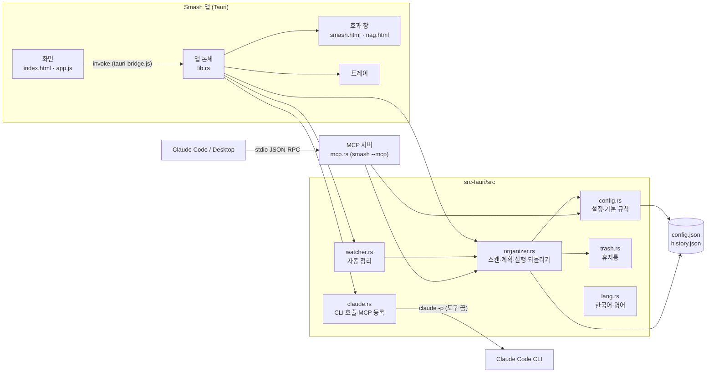

# Smash! 설계서

> 2026-11-05: v1.1.0(Electron) 코드를 보고 정리한 뒤, 2.0.0 Tauri 전환에 맞춰 고쳤다.
> 함께 보기: [기획서](기획서.md) · [구현도](구현도.md) · [결정기록](결정기록.md)

## 기술 스택

| 영역 | 고른 것 | 이유 |
|---|---|---|
| 앱 틀 | Tauri 2 (2.0.0부터) | 설치 파일이 120MB 안팎에서 몇 MB로 줄고 메모리도 덜 쓴다. 같은 실행 파일을 `--mcp`로 띄우면 MCP 서버가 된다 |
| 화면 | 프레임워크 없는 순수 HTML·CSS·JS | 화면이 탭 몇 개라 빌드 단계 없이 간다. `scripts/build-web.js`가 `dist-web`에 복사만 한다 |
| 언어 | Rust (앱·규칙 엔진·MCP), JavaScript (화면) | 앱과 MCP 서버가 같은 crate 모듈(`organizer`, `config`, `watcher`)을 쓴다 |
| 테스트 | `cargo test` | 1.x의 Node 테스트를 Rust로 옮겼다. 설정 위치·언어가 전역이라 `--test-threads=1` |
| 패키징 | Tauri 번들러 + GitHub Actions | 맥 유니버설 dmg(서명·공증), NSIS exe, 자동 업데이트 파일과 `latest.json` |
| AI 연동 | `claude -p` CLI, stdio MCP | API 키 없이 사용자 PC에 로그인된 Claude를 쓴다 |

### 앱 틀 후보 비교

| 후보 | 장점 | 걸린 점 | 결과 |
|---|---|---|---|
| Electron (1.x) | 바로 만들 수 있었다. 앱 실행 파일을 `ELECTRON_RUN_AS_NODE=1`로 돌려 MCP 서버를 띄웠다 | 설치 파일 120MB 안팎, 트레이에 상주하는 앱치고 무겁다 | 1.x에서 씀 |
| Tauri 2 (2.0.0) | 설치 파일이 몇 MB, 시스템 웹뷰를 쓴다. 같은 일을 먼저 옮긴 포켓몬 키우기에서 크기 198MB→5.9MB를 확인했다 | 규칙 엔진을 Rust로 다시 써야 한다. 이 맥에 Rust가 없어 컴파일·테스트는 GitHub Actions에서 한다 | 고름 |
| Wails·Flutter 데스크톱 | - | 화면을 다시 써야 하고, 트레이·투명 창 지원이 Tauri보다 얕다 | 안 고름 |

근거: 다른 Electron 앱들을 Rust로 옮기는 보고서(2026-11)와 포켓몬 키우기 v1.1.0 전환 결과. 자세한 내용은 [결정기록](결정기록.md).

## 전체 아키텍처

GUI와 MCP 서버가 같은 Rust 모듈과 같은 설정·기록 파일을 쓴다. 그래서 앱에서 만든 규칙으로 Claude도 정리하고, Claude가 한 정리도 앱에서 되돌린다.



- MCP 서버는 앱 실행 파일 자체다: `command = 앱 실행 파일 경로`, `args = ["--mcp"]`, `env = {}`([claude.rs `Launch`](../src-tauri/src/claude.rs), [main.rs](../src-tauri/src/main.rs)). `--mcp`로 뜨면 창 없이 stdin/stdout만 쓴다.
- 1.x는 Electron 실행 파일 + `server.js` 경로를 등록했다. 2.0은 앱을 켤 때 이미 `smash`가 등록된 곳(Claude Code 설정 위치들, Claude Desktop)에서 명령이 지금 실행 파일과 다르면 바꿔 쓴다(`refresh_registrations`). 등록 안 된 곳은 건드리지 않는다. 개발 빌드, 디스크 이미지에서 바로 띄운 경우(App Translocation, `/Volumes/`)도 건드리지 않는다.
- 화면은 1.x의 `window.tidy` 모양을 그대로 쓴다. [tauri-bridge.js](../src/renderer/tauri-bridge.js)가 각 함수를 Tauri 명령(`config_get`, `scan`, `apply` …)으로 잇고, 이벤트(`auto:ran`, `ui:tab`, `config:changed`)를 `listen`으로 받는다.

## 데이터 구조

### 설정 파일 `config.json`

| 위치 | 경로 |
|---|---|
| macOS | `~/Library/Application Support/Smash/config.json` |
| Windows | `%APPDATA%\Smash\config.json` |
| 그 밖 | `$XDG_CONFIG_HOME/smash/config.json` |
| 테스트 | `SMASH_HOME` 환경 변수로 바꿈 |

```json
{
  "version": 2,
  "targets": [
    {
      "id": "downloads",
      "path": "~/Downloads",
      "auto": false,
      "rules": [
        {
          "id": "r_...",
          "name": "사진·이미지",
          "enabled": true,
          "match": { "extensions": ["jpg", "png"], "nameIncludes": [], "olderThanDays": 0 },
          "action": "move",
          "dest": "~/Documents/사진·이미지"
        }
      ]
    }
  ],
  "skip": { "hidden": true, "patterns": ["*.crdownload", "*.part", "..."] },
  "ai": { "model": "sonnet" },
  "settings": { "autoDelaySec": 10, "notify": true, "openAtLogin": false, "smash": true, "openAfter": true, "language": "system" }
}
```

- 규칙은 정리 대상 폴더(`targets`)마다 따로 있고, 위에서부터 처음 맞는 규칙 하나만 적용한다.
- 조건이 하나도 없는 규칙은 아무 파일도 잡지 않는다(실수로 전부 옮기는 것을 막음).
- `normalize`가 읽을 때마다 값을 정리한다: `autoDelaySec`은 3~3600초, 확장자는 소문자·점 제거, `action`은 `move`/`trash`만.
- 쓰기는 임시 파일에 쓰고 `rename` 하는 방식(`write_json_atomic`)이라 GUI와 MCP 서버가 동시에 써도 반쯤 쓴 파일이 남지 않는다.

### 기록 파일 `history.json`

- 정리 한 번이 `run` 하나: `{ id, at, source: "app" | "auto" | "claude-mcp", ops: [{ type: "move", from, to } | { type: "trash", from }], undone }`.
- 최근 50건만 둔다(`HISTORY_LIMIT`).
- 되돌리기는 가장 최근의 안 되돌린 `run`에서 `move`만 원래 자리로 돌린다. 휴지통으로 간 파일은 휴지통에서 직접 꺼내야 한다.

### 외부 연동

| 대상 | 방식 | 보내는 것 |
|---|---|---|
| Claude Code CLI | `claude -p --output-format json --tools "" --no-session-persistence --strict-mcp-config --setting-sources ""`, 가능하면 `--json-schema` | 파일 이름·크기·날짜, 폴더 목록. 파일 내용은 안 보냄 |
| Claude Code 설정 | `claude mcp add`로 등록. 기본 `~/.claude.json`, Orca 프로필, `CLAUDE_CONFIG_DIR` 위치를 찾아 고른 곳에 등록 | MCP 실행 명령 |
| Claude Desktop 설정 | `claude_desktop_config.json`을 `.bak`으로 백업한 뒤 `mcpServers.smash` 추가 | MCP 실행 명령 |
| 자동 업데이트 | `releases/latest/download/latest.json`을 15초 뒤, 그 뒤 6시간마다 확인하고 설정 탭·트레이에서 바로 확인할 수도 있다. 서명(minisign) 맞는 파일만 받는다. 새 버전은 받아 두고 알림 한 번, 설치는 사용자가 누를 때 | 없음(받기만) |

### MCP 도구

| 도구 | 하는 일 |
|---|---|
| `list_targets` | 정리 대상 폴더와 규칙 목록 |
| `scan_folder` | 한 폴더를 규칙대로 훑어 계획을 돌려줌(옮기지 않음) |
| `apply_plan` | 계획을 실행. 앱과 같은 안전장치를 거친다 |
| `add_rule` | 규칙 추가. 조건이 하나 이상 있어야 한다 |
| `undo_last` | 마지막 정리 되돌리기 |
| `history` | 정리 기록 |

## 플랫폼별 차이

| 항목 | macOS | Windows | Linux(코드만) |
|---|---|---|---|
| 휴지통 | `osascript -l JavaScript`로 `NSFileManager.trashItemAtURL` 호출(Finder 자동화 권한 불필요) | PowerShell에서 `Microsoft.VisualBasic.FileIO.FileSystem.DeleteFile(..., SendToRecycleBin)` | `~/.local/share/Trash`에 직접 옮기고 `.trashinfo` 작성 |
| 트레이 | 메뉴 막대, 템플릿 아이콘(`trayTemplate.png`) | 알림 영역, 컬러 아이콘(`tray-color.png`) | - |
| 앱 이름 | 번들 `Smash.app`, 실행 파일 `smash`, 화면 이름 `Smash!`는 `build/lproj/*/InfoPlist.strings` | NSIS 설치(사용자 계정), 식별자 `dev.haul.smash` | - |
| 창 숨김 | 창을 닫으면 Dock 아이콘도 숨긴다(`ActivationPolicy::Accessory`) | 작업 표시줄에서 사라짐 | - |
| 로그인 시 실행 | LaunchAgent, `--hidden` 인자 | 레지스트리 Run 키, `--hidden` | - |
| 한글 파일 이름 | 파일 시스템이 NFD로 돌려주므로 NFC로 맞춰 비교 | 해당 없음 | 해당 없음 |
| `claude` CLI | 실행 파일 직접 실행 | npm 설치본 `claude.cmd`는 셸을 거쳐 실행, 이때 `--json-schema`는 빼고 텍스트 JSON을 해석 | - |
| OS 언어 | `defaults read -g AppleLanguages`로 읽는다(앱·MCP 같음) | `sys-locale` | `sys-locale` 또는 `LANG` |

## 보안·권한

- 화면은 Tauri 권한 `core:default`만 갖는다(`capabilities/default.json`, 창 `main`·`nag`). 파일·셸·대화상자는 화면에 열지 않고 Rust 명령 안에서만 쓴다. 효과 창(`smash`)은 권한이 없다.
- CSP는 `tauri.conf.json` 한 곳에서 건다(`default-src 'self'; script-src 'self'; style-src 'self'; img-src 'self' data:`). 인라인 style도 막혀서 동적 스타일은 data 속성과 클래스로 처리한다.
- 모든 창은 앱 밖 주소로 이동하지 못한다(`on_navigation`). 외부 링크는 `shell_open_url`이 https만 브라우저로 연다. 효과 창은 마우스를 통과시킨다(`set_ignore_cursor_events`).
- 자동 업데이트 파일은 저장소 비밀 키로 서명하고, 앱은 `tauri.conf.json`의 공개 키로 확인한 것만 설치한다.
- 파일 작업 안전장치([`apply_plan`](../src-tauri/src/organizer.rs)):
  - 원본과 목적지가 모두 등록한 정리 대상 폴더 안이어야 한다. 밖이면 거부(MCP로 들어온 요청도 같다).
  - 실행 직전에 목적지를 다시 계산해서 그사이 같은 이름이 생겼으면 덮어쓰지 않고 이름을 바꾼다.
  - 중복으로 버리기로 한 파일은 원본이 아직 같은 내용으로 있을 때만 버린다. 아니면 원본 자리로 옮긴다.
  - 디스크가 다르면 새 파일로만 복사(이미 있으면 실패)한 뒤 원본 삭제.
- Claude에는 파일 내용을 보내지 않는다. CLI는 도구를 모두 끄고(`--tools ""`), 세션을 남기지 않고, 사용자의 다른 MCP·설정을 읽지 않게 띄운다.
- macOS 권한: 다운로드·문서 폴더 접근은 OS가 처음 접근할 때 묻는다. 앱이 따로 권한을 요청하는 코드는 없다.

## 알려진 한계

- 맥은 2.0.0부터 Developer ID 서명·공증. Windows 설치 파일은 아직 코드 서명이 없어 SmartScreen 경고가 뜬다. 시스템 알림은 권한에 따라 안 뜰 때가 있어 자동 정리 알림은 잔소리 배너를 직접 그린다.
- Windows는 실기기에서 테스트하지 않았다.
- 이 개발 맥에는 Rust가 없어서 컴파일·테스트는 GitHub Actions(`build.yml`)에서 한다.
- 휴지통으로 보낸 파일은 되돌리기로 복구하지 않는다.
- 스캔은 폴더 바로 아래 파일만 본다. 하위 폴더 속 파일은 정리하지 않는다.
- 자동 정리는 `notify` crate의 폴더 이벤트(하위 폴더 제외)와 10분마다 한 번 훑기로 동작한다. 감시가 끊기면 30초 뒤 다시 건다.
- Claude 자리 묻기는 한 번에 파일 200개까지만 보낸다(`MAX_FILES_PER_REQUEST`, [claude.rs](../src-tauri/src/claude.rs)).
